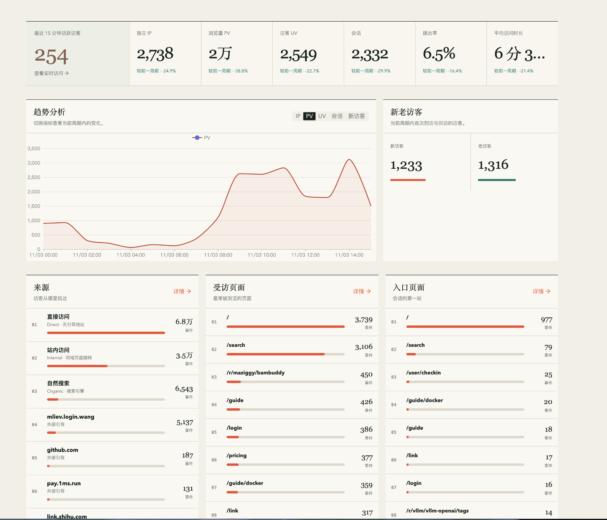
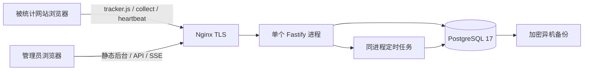

# WebPulse（网站脉搏）项目技术文档

> 轻量级、自托管网站流量统计系统 · 产品与研发实施基线
>
> 文档版本：1.1.0　｜　更新日期：2026-11-04　｜　状态：M0 核心契约已冻结，业务待实施
>
> 技术栈：Fastify + TypeScript / React + Ant Design + ECharts / PostgreSQL
>
> 部署目标：1–2GB 内存的单台 Linux VPS；推荐 2GB。本文是技术设计成品，附带可编辑的数据库和部署参考文件；并非已实现的应用源码或已完成的性能测试报告。

M0 修订处理 R01–R07。具体约束见 [统计与采集契约](统计与采集契约.md)、[删除与覆盖契约](删除与覆盖契约.md)，验收映射见 [M0 设计冻结与验收](../docs/M0设计冻结与验收.md)。正文中的七份 `reference/` 代码块保留 v1.0 快照；实际源码与迁移以仓库应用目录为维护源，后续 Schema 按新增迁移实现。

2026-11-06：M5 本机加固、安全/三浏览器/崩溃回归已交付；用户明确停止压测，目标 VPS 另验，数据库镜像安全扫描仍阻断生产放行。实际证据及第 17.3 节映射见 [M5 加固与验收](../docs/M5加固与验收.md)，本文性能目标不构成已测容量声明。

## 目录

1. [产品定位与设计原则](#1-产品定位与设计原则)
2. [MVP 范围与版本边界](#2-mvp-范围与版本边界)
3. [功能与页面需求](#3-功能与页面需求)
4. [UI 与交互规范](#4-ui-与交互规范)
5. [技术栈与依赖管理](#5-技术栈与依赖管理)
6. [系统架构与关键流程](#6-系统架构与关键流程)
7. [统计口径与边界条件](#7-统计口径与边界条件)
8. [数据采集 SDK 设计](#8-数据采集-sdk-设计)
9. [匿名化、隐私与保留策略](#9-匿名化隐私与保留策略)
10. [PostgreSQL 数据模型与索引](#10-postgresql-数据模型与索引)
11. [API 契约与请求响应示例](#11-api-契约与请求响应示例)
12. [实时 SSE](#12-实时-sse)
13. [聚合、查询与数据清理](#13-聚合查询与数据清理)
14. [Docker Compose 部署与运维](#14-docker-compose-部署与运维)
15. [性能、可靠性与安全要求](#15-性能可靠性与安全要求)
16. [项目目录与代码约定](#16-项目目录与代码约定)
17. [测试、验收与里程碑](#17-测试验收与里程碑)
18. [风险、演进与决策记录](#18-风险演进与决策记录)
19. [参考资料与交付说明](#19-参考资料与交付说明)

## 1. 产品定位与设计原则

### 1.1 产品定义

**WebPulse（网站脉搏）是一套面向个人开发者、小型网站和内容团队的轻量级、自托管网站分析系统。** 通过一段 JavaScript 收集经过最小化处理的浏览与前台活动数据，提供流量总览、实时活跃、访问来源、受访页面、入口页面及新老访客分析。

- 英文名称：WebPulse；中文名称：网站脉搏。
- 建议仓库名：`webpulse`。名称、商标和域名占用尚未核查。
- 核心价值：数据自持、指标透明、接入简单、低资源运行、界面安静易读。
- 典型场景：个人博客、产品官网、文档站、轻量工具站、小型内容平台。
- 非目标：广告归因平台、用户画像系统、支付分析、服务端请求审计、精确人数识别、会话录像。

### 1.2 用户与使用路径

MVP 只有一名管理员，可管理多个站点。管理员登录 → 创建站点 → 配置允许采集的 Origin → 复制 SDK 接入代码 → 验证首条 PV → 查看仪表盘与实时访问。访客无需注册；SDK 不读取网站登录身份。

“一个浏览器标识”不等于一个自然人；“独立 IP”也不等于人数。所有统计页面均通过指标说明暴露这一限制。

### 1.3 设计原则

1. **口径先行。** 先定义时间、去重、归因、会话和分母，再实现图表。
2. **资源可控。** 单服务、单数据库、有限并发、短期明细、定时聚合；不在 MVP 引入 Redis、Kafka 或 ClickHouse。
3. **采集与管理隔离。** 公开采集端点只能写入受限统计；报表、站点设置和实时流必须登录。
4. **隐私最小化。** 不采集输入框、完整查询参数、登录 ID、完整 UA 或精确屏幕尺寸。2026-11-06 按用户要求增加真实 IP 访问记录，随事件明细保留并仅向已登录管理员展示，见第 9.1 节。
5. **可解释的准确性。** PV/UV 采用精确去重；前台时长是估计值；拒绝、屏蔽、丢包会导致少计，不宣称绝对完整。
6. **克制的视觉。** 延续参考截图的米色、细线、低饱和强调色和宽松排版。

## 2. MVP 范围与版本边界

### 2.1 首次发布范围

| 能力 | MVP 内容 | 完成标准 |
|---|---|---|
| 接入 | 独立 JS、传统多页与 History SPA | 首次加载、路由变化、前进后退均正确上报 |
| 指标 | PV、UV、独立 IP、会话、跳出率、平均前台活跃时长 | 实现第 7 节口径及边界测试 |
| 实时 | 最近 15 分钟活跃、分钟趋势、当前页面 | SSE 5 秒更新；断线可恢复完整快照 |
| 分析 | 来源、受访页面、入口、退出、新老访客 | 支持日期与站点切换，排行单位明确 |
| 管理 | 单管理员、最多 5 个站点的初始资源配置 | 每站独立 public ID、Origin、时区、保留设置 |
| 隐私 | 同意开关、退出、URL 清洗、IP HMAC | 拒绝时零采集；日志不出现原始 IP/敏感 URL |
| 部署 | Compose、Nginx、持久卷、健康检查、备份流程 | 新机器按文档部署、重启、恢复通过 |
| 运维 | 聚合、清理、容量与采集状态 | 可看见聚合延迟和最后采集时间 |

多站点基础能力在本版纳入，以避免后续补站点隔离；账号邀请和成员权限不纳入。实时 SSE 在本版纳入，以符合“网站脉搏”的定位。设备、地域和任意自定义事件延后；MVP 仅支持用于跳出判断的通用 `interaction` 信号。

### 2.2 后续版本

| 阶段 | 内容 | 前置条件 |
|---|---|---|
| P1 | 粗粒度浏览器/系统/设备；本地 IP 地域库；白名单自定义事件 | 隐私开关、事件 Schema、存储预算明确 |
| P1 | CSV 导出、更多来源规则、站点排除规则 | 超时与输出限额、脱敏与权限验证 |
| P2 | 多用户、站点授权、告警、分享报表 | 权限模型与审计完成 |
| P2 | 多实例与 Redis；分区与更长历史去重 | 单机监控证明瓶颈，完成一致性设计 |

### 2.3 MVP 限额与产品限制

- 默认单次查询最多 365 个完整自然日；分钟粒度最多 24 小时，小时粒度最多 7 日。
- 日粒度 PV、已结束会话及比率汇总默认保留 365 日；精确跨日 UV/IP 保留 90 日；分钟/小时去重和事件明细保留 30 日。
- 日期查询采用**站点配置时区**，公开筛选只接收自然日范围；今日及内部同期比较允许部分日期，截止边界和查询路径见 7.5。
- 90 日以前的单日日 UV/IP 仍可显示已保存的精确日值；包含过期日期的多日 UV/IP 返回 `null` 并说明不可用，不相加冒充去重结果。
- 不支持任意属性组合筛选、跨站点 UV 或跨域统一身份。
- 1GB 配置用于低流量起步；可承载上限通过目标机器上的压测确认。

## 3. 功能与页面需求

### 3.1 全局框架

顶部显示品牌、站点切换、站点时区、日期选择和管理员菜单。导航为“总览 / 实时 / 来源 / 页面 / 访客 / 站点设置”。常用日期包括今日、昨日、近 7 日、近 30 日和自定义日期。

所有报表共享 `site_id + start_date + end_date`（结束日期不含），独立站点缓存；切换站点立即取消旧请求。首屏可骨架加载，后续刷新保留旧数据并标记“更新中”；请求失败时显示错误和重试，不能用 0 替代失败。

### 3.2 总览 `/overview`

| 区域 | 需求 | 交互与数据规则 |
|---|---|---|
| 七项指标 | 15 分钟活跃、独立 IP、PV、UV、会话、跳出率、平均时长 | 活跃卡链接实时页；每卡含口径 Tooltip；时长不截断 |
| 周期比较 | 与上一等长周期比较 | 今日只对比上一日相同本地墙钟时刻；基期为 0 显示“—” |
| 趋势 | IP / PV / UV / 会话 / 新访客切换 | 默认 PV；缺失数据区分无流量与未完成聚合 |
| 新老访客 | 新访客数、老访客数与占比 | 两者相加等于当前范围 UV |
| 三列排行 | 来源、受访页面、入口页面各 Top 8 | 来源单位“会话”，受访单位“PV”，入口单位“会话” |
| 数据状态 | 采集时间、聚合时间、暂定标识 | 有未结束会话时，跳出率和时长注明只含已结束会话 |

会话卡显示“本期开始的会话”，跳出率卡显示“已结束会话”；二者分母并不相同。来源不把内部页面跳转作为新来源。截图中“事件”统一计量标签改成上述明确单位。

### 3.3 实时 `/realtime`

- 顶部：15 分钟活跃访客、最近一分钟 PV、SSE 连接状态、最后更新时间。
- 左侧：最近 15 分钟分钟 PV；右侧：活跃页面 Top 10。
- 列表：经过脱敏的最近页面、真实 IP、来源分类、最后活动时间；不暴露访客 ID/IP HMAC。访客分析提供所选日期内的分页访问记录。
- “当前页面”按每个访客最近一次有效前台活动对应页面计数，多标签页只占一个访客。相同时间戳以服务端写入顺序稳定决胜。
- 页面不可见后暂停实时订阅；重新显示获取新快照。采集延迟或流连接断开时显示“数据可能延迟”。

### 3.4 来源 `/sources`

按会话来源显示渠道、来源域名、会话数和占比，支持进入来源详情；UTM 仅展示白名单值。来源归因在会话第一条 PV 时锁定，内部跳转、心跳和随后变化的 UTM 不覆盖它。

渠道包括 `direct / organic / referral / campaign / unknown`。无法确定来源不强行归为自然搜索。搜索来源按维护中的域名规则识别，搜索词不采集。

### 3.5 页面 `/pages`

页签为“受访 / 入口 / 退出”。表格显示排名、标准化路径、计数、占比。受访统计 PV；入口和退出统计会话。退出页面只来自已结束会话，退出数加总等于本期开始且已结束会话数。路径搜索长度 ≤128，查询参数化；分页每页默认 20，最大 100。

### 3.6 访客 `/visitors`

显示新老访客、UV 趋势和说明。新老分类相对整个所选周期，不按每天的新老结果相加。MVP 不展示实名、单个访客详情、访问频次分群或跨设备合并。

### 3.7 设置与接入 `/sites`、`/sites/:id/settings`

站点字段：名称、主 Origin、允许的 Origin 列表、站点时区、启用状态、采集过滤规则、保留天数。创建后 public ID 不可修改；产生首条数据后时区锁定。改时区须新建站点或执行离线重建流程。

提供 SDK 片段、CSP 接入提示、最近成功采集时间与最近拒绝原因的聚合计数。“暂停”在持站点冲突写锁排空在途采集并提交后返回成功，此后旧请求不能再提交；“删除”要求输入站点名称，原子禁用并建立持久化任务，后台分批删除后报告完成。公开站点 ID 不称为 API 密钥。

管理员通过部署端 CLI 首次创建；无公开注册、默认密码或开放安装向导。登录会话过期时停止 SSE，返回登录页，保留本次日期和站点选择。

## 4. UI 与交互规范

### 4.1 参考视觉与布局

依据原对话附图：米色页面底、近白卡片、顶部深色细横线、七列指标、趋势图与新老访客 16:8 分栏、底部三列排行。图表与表格为主，不使用厚重阴影、渐变背景或密集彩色徽章。



图中数值仅用于视觉参考，不作为统计对账数据；指标单位与跳出/时长口径以本文为准。

```text
品牌 / 导航                    站点 ▼   日期 ▼   时区   管理员
┌ 活跃 ┬ IP ┬ PV ┬ UV ┬ 会话 ┬ 跳出率 ┬ 平均时长 ┐
├───────────────────────────┬─────────────────┤
│ 趋势分析（16 / 24）        │ 新老访客（8 / 24）│
├──────────────────┬────────┴────────┬────────┤
│ 来源（8 / 24）    │ 受访（8 / 24） │ 入口（8 / 24）│
└──────────────────┴─────────────────┴────────┘
```

### 4.2 设计 Token

| Token | 值 | 用途 |
|---|---|---|
| `background` | `#F0EEE7` | 页面背景 |
| `surface` | `#FAF9F5` | 卡片与表格 |
| `surfaceMuted` | `#ECEFE7` | 实时活跃卡 |
| `textPrimary` | `#24312D` | 正文与数值 |
| `textSecondary` | `#626B64` | 副说明；在米白背景上保持可读性 |
| `border` | `#D8D2C5` | 表格分割和次级边线 |
| `borderStrong` | `#24312D` | 卡片顶部 1px 横线 |
| `accent` | `#D75C45` | 图表线条、进度条；正文链接用更深的 `#A63C2B` |
| `secondaryAccent` | `#26776B` | 老访客与中性对比 |
| `focus` | `#266B85` | 键盘焦点 2px 描边 |
| `radius` | `2px` | 卡片、按钮、输入 |
| `spacing` | `4 / 8 / 12 / 16 / 24 / 32 / 48px` | 间距序列 |

正文采用系统中文字体 `-apple-system, BlinkMacSystemFont, "Segoe UI", "PingFang SC", "Microsoft YaHei", sans-serif`。标题可加衬线中文回退，数字使用等宽数字特性 `font-variant-numeric: tabular-nums`，不依赖远程字体。

正文 14px/1.6，说明 12–13px，区块标题 22–24px，指标值桌面 36–44px、窄屏 28px。时长完整显示“6分03秒”；金额式缩写不用于原始计数，超过万时可简写并在 Tooltip 给出整数。

### 4.3 响应式

- ≥1440px：内容最大宽 1800px，左右 40px；7 列指标；趋势 16:8；排行三列。
- 1024–1439px：左右 24px；指标 4+3；趋势保持 16:8 或按内容转 15:9。
- 768–1023px：指标 3 列；趋势与访客上下排列；排行榜 2 列。
- <768px：左右 16px；指标 2 列、活跃卡通栏；图表和排行单列；表格保留核心两列。
- 筛选器换行，不靠横向滚动承载主导航。图表高度桌面 340px，移动 260px。

### 4.4 Ant Design 主题示例

```tsx
<ConfigProvider theme={{
  token: {
    colorPrimary: '#26776B', colorBgLayout: '#F0EEE7',
    colorBgContainer: '#FAF9F5', colorText: '#24312D',
    colorTextSecondary: '#626B64', colorBorder: '#D8D2C5',
    borderRadius: 2, fontSize: 14,
    fontFamily: '-apple-system, BlinkMacSystemFont, "Segoe UI", "Microsoft YaHei", sans-serif',
    controlHeight: 34
  },
  components: {
    Card: { paddingLG: 24 },
    Table: { headerBg: '#F0EEE7', rowHoverBg: '#EEECE3' }
  }
}}>{children}</ConfigProvider>
```

主题通过官方 `ConfigProvider` Token 机制配置；具体组件 Token 以项目锁定版本的类型校验为准。[Ant Design 主题文档](https://ant.design/docs/react/customize-theme/)

### 4.5 图表、状态与可访问性

ECharts 折线宽 2px、默认无散点，网格淡色；默认 `smooth: false`，防止平滑曲线制造不存在的峰值。面积填充 opacity 0.06；IP/PV/UV 使用可区分颜色及文字图例。Tooltip 展示站点时区与完整值。

涨跌方向与好坏分开：PV 下降不自动表示异常；跳出率上升通常是关注项；文字同时标记“↑/↓”，不能仅靠颜色。百分比变化用相对变化，跳出率变化额外展示百分点，例如 20% → 15% 为 `-5 个百分点 / -25%`。

支持键盘操作、可见焦点、表单错误关联、至少 44px 移动触控区、图表文字摘要与表格替代；遵循系统减少动画偏好。空状态包括“未接入”“无流量”“数据过期”“权限失效”“查询失败”“聚合处理中”，各自给出明确行动。

## 5. 技术栈与依赖管理

| 层级 | 选择 | 决策理由 |
|---|---|---|
| 运行时 | Node.js 24 LTS 系列，固定受支持安全补丁 | 成熟的 TypeScript 生态；满足 Fastify 5 的运行要求 |
| 后端 | Fastify 5 + TypeScript strict | Schema 校验、插件封装、低开销 HTTP 服务 |
| 数据访问 | `pg` + 参数化 SQL + SQL 迁移 | 明确控制 DISTINCT、锁和聚合；MVP 不引入双套 ORM |
| 前端 | React + TypeScript + Vite | 静态构建，VPS 不运行开发服务器 |
| UI / 图表 | Ant Design + ECharts 按需导入 | 减少界面开发成本，保持主题一致 |
| 前端状态 | React Router + TanStack Query | URL 筛选状态、取消过期请求、缓存与重试 |
| SDK | 原生 TypeScript + esbuild | 无框架依赖，目标现代浏览器 |
| 数据库 | PostgreSQL 17，固定安全补丁 | 单机明细、索引、事务及聚合统一存储 |
| 边缘 | Nginx 稳定版 + TLS | 静态资源、代理、连接与请求限额 |
| 工程 | pnpm workspace、ESLint、Prettier | 共用 Schema、统一构建和锁文件 |
| 测试 | Vitest、Fastify inject、Playwright、k6 | 单元、集成、浏览器与负载验证 |

版本基线是本项目的选型，不表示各组件的“最新版”。实施时提交精确 `package.json`、`pnpm-lock.yaml` 和镜像 digest；依赖升级经 CI 后发布，禁止生产使用浮动 `latest`。Fastify 5 要求 Node.js 20+，并要求完整的 JSON Schema；本项目使用受支持的 Node 24 系列。[Fastify 迁移说明](https://fastify.dev/docs/latest/Guides/Migration-Guide-V5/)、[Node.js 发布计划](https://github.com/nodejs/Release)

PostgreSQL 17 仍处于官方支持周期；小版本升级按官方政策保持安全维护。主版本升级走备份恢复或 `pg_upgrade`，不能只改容器标签。[PostgreSQL 版本政策](https://www.postgresql.org/support/versioning/)

## 6. 系统架构与关键流程

### 6.1 部署拓扑



前端与管理 API 同 Origin；SDK 加载与采集允许跨 Origin。Nginx 直接提供构建后的前端和 SDK；Fastify 不再存储静态副本。PostgreSQL 不映射公网端口。

单进程负责采集、报表、SSE、聚合与清理。采集写入事务提交后才返回成功；不设置会在崩溃时丢失已确认数据的内存写队列。SSE 缓存和报表缓存允许丢失，可从数据库重建。

### 6.2 模块边界

| 模块 | 职责 |
|---|---|
| collection | Content-Type/Schema、Origin、过滤、HMAC、幂等接入 |
| identity | 站点隔离的访客键、保留策略、隐私信号 |
| sessions | 行锁下建会话、入口来源、前台区间、关闭状态 |
| statistics | 统一口径查询、范围校验、缓存与元信息 |
| aggregation | 小时/日/页面/来源聚合、脏桶与水位 |
| realtime | 共享快照、SSE 连接、背压和清理 |
| auth / sites | 管理登录、CSRF、配置、站点数据隔离 |
| maintenance | 清理、健康、任务监控、站点删除 |

### 6.3 采集事务

1. 入口限额 → 解析受限 JSON → 预检 public site ID、Origin、隐私信号、过滤规则和 URL 清洗。
2. 开启 READ COMMITTED 事务，对站点取 `FOR SHARE`，复核启用/删除状态与最新配置；直到提交前持续持锁。
3. 计算站点隔离的 HMAC 后丢弃原值；取得事务级访客 advisory lock，再锁已存在的访客行。不得在幂等检查前更新访客。
4. 先检查已确认事件及版本化指纹；相同重试无副作用，冲突 409。然后按访客、会话、页面、排序后的脏桶锁序处理新事件。
5. 新 PV 由服务端建/续会话；新互动与心跳在锁内检查关闭、30 分钟超时和 12 小时上限；更新事实与成员。
6. 整批提交后返回 204；任何失败整批回滚，数据库不可用 503，不宣告成功。取锁等待及事务必须服从请求硬期限。

完整事务、禁用线性化时点及重试指纹见 [统计与采集契约第 1–4 节](统计与采集契约.md)。不同访客共享站点读锁，同访客由访客锁串行化；数据库唯一约束兜底。新会话的 `page_views=1` 已含首条 PV，仅后续新 PV 加 1。一个批次只允许同站同访客，批内相同 ID 先判重。

### 6.4 时间策略

- `received_at` 是取得站点/访客锁后首次接纳新事件的数据库 `clock_timestamp()`，不是 HTTP 到达或事务开始时间；批次共用该时间，重复事件保持首次时间。回拨和单调活动序号遵守统计与采集契约第 1 节。
- `occurred_at` 在本版定义为 `received_at`，作为所有 PV、UV/IP 桶的事件时间；不使用客户端时钟重写历史。
- 客户端 `client_ts` 只用于时钟偏差/延迟的聚合诊断，不持久化每条原值，不做长时间离线补报。
- 心跳的短区间是时长估计输入，不改变 PV 的归属时间；网络重试可能把新事件归入更晚时间，属于已知限制。
- 站点日边界通过 IANA 时区计算；数据库存 `timestamptz`，连接时区统一 UTC。`local_date` 在写入时按站点时区生成。

## 7. 统计口径与边界条件

### 7.1 全局规则

所有范围为左闭右开 `[start, end)`；日范围从站点自然日转换为 UTC 边界。未来范围拒绝；进行中的今日以 `as_of` 为上限。夏令时地区可能一天有 23/25 小时，使用时区库计算边界，不使用 `+86400 秒` 假设自然日。

机器人排除、路径排除、Origin 拒绝在写入前执行。改变规则只影响未来数据，默认不追溯修改历史；每次变更记录 `rule_version`。同一站点所有页面使用同一 `metric_version=1`。

### 7.2 指标字典

| 指标 | 唯一定义 | 时间归属 / 分母 |
|---|---|---|
| PV | 接受且去重后的 `page_view` 数 | PV 的 `occurred_at` 在范围内 |
| UV | 范围内有 ≥1 条有效 PV 的不同 `visitor_key` 数 | 不包括仅有心跳的访客 |
| 独立 IP | 范围内有效 PV 的不同 `ip_key` 数 | 完整规范化 IP 的站点级 HMAC，不等于人数 |
| 会话数 | 服务端新建会话数 | `started_at` 在范围内，包括仍开放会话 |
| 已结束会话 | 上述会话中 `status=closed` 的数量 | 跳出率、平均时长的共同分母 |
| 跳出会话 | 已结束会话中 `page_views=1 AND interactions=0` | 不以停留时长替代互动判断 |
| 跳出率 | `bounced_sessions / closed_sessions × 100%` | 无已结束会话时为 `null` |
| 平均访问时长 | 已结束会话 `active_ms` 总和 / 已结束会话数 | 展示名附“前台估计”；无会话为 `null` |
| 新访客 | 本期 UV 中 `first_seen_pv_at >= start` 的数量 | 首次可观测 PV，受标识寿命影响 |
| 老访客 | 本期 UV 中 `first_seen_pv_at < start` 的数量 | `新 + 老 = UV` |
| 实时活跃 | `(as_of-15min, as_of]` 内有有效 PV 或前台心跳的不同访客 | 与全局日期筛选无关；按当前时刻滚动 |

UV、IP 是非可加指标。一个访客 10:00、11:00 各访问一次：每小时 UV 都是 1，当日 UV 是 1；同一访客同一天可能先被日内称为新、后来回访，但整个所选周期只能归为新或老之一。

### 7.3 会话与来源

- 按 `site_id + visitor_key` 管理开放会话；客户端 session ID 仅可作诊断，不能决定归属。
- 距离最近有效 PV、前台心跳或有效互动 **≥30 分钟**时，旧会话关闭，下次有效 PV 新建会话；29 分 59 秒继续旧会话。
- 会话最长 12 小时。达到上限后旧会话关闭；下一次前台上报先产生一个 `reason=resume` 虚拟 PV，开启新会话，以保证每个会话至少一条 PV。
- 跨自然日不主动切断会话；跨标签页共享服务端会话；浏览器退出不立即关闭，后台任务按超时结算。
- 失效会话的旧页面心跳和新互动均不复活会话；同 ID 已确认互动重试可无副作用返回成功。SDK 收到 `session_expired` 后生成新 page view ID 并先上报 `resume` PV；后台标签页恢复且已超时也执行该流程。此类恢复 PV 计入浏览量，界面口径说明可查。
- 会话的入口、来源、UTM 在首次 PV 锁定。退出路径是最后一条 PV 的路径，不由 `unload` 决定。

来源优先级：有效白名单 UTM → 外部搜索引擎域名 → 外部引荐域名 → 空/本站引荐记为 direct → 解析失败记为 unknown。MVP 不做跨会话“最后非直接来源”继承。

一个 `23:55–00:10` 的会话：前后两天的 PV 各记各天；会话数、入口来源、最终跳出率与**完整会话时长**全部归入 23:55 所在日。会话范围与 PV 范围因而不完全一致，这是固定规则。

### 7.4 互动与前台时长

“有效互动”只在页面可见时，由 SDK 监听到可信输入后产生，MVP 包括点击、键盘操作和滚动；仅记录布尔信号，每页最多记一次。服务端无法证明客户端未被篡改，公开采集本身不能防止蓄意伪造。

点击/键盘依据可信输入事件；滚动须与最近 1 秒内的可信 wheel/touchmove 输入关联，不能仅凭 scroll 事件判断，避免程序滚动被记为互动。只记录类别，不读取按键值、输入内容、点击文本或元素属性。

心跳、路由加载、定时器和程序模拟事件不构成有效互动；心跳可延续会话，但不让单页长读自动变成非跳出。因此跳出率不等同于内容质量或参与率，与其他平台比较必须先对齐规则。

时长计算采用以下可实现的估计方法：

1. SDK 以 `performance.now()` 累计页面可见时长，15 秒发送一次 `total_visible_ms`；隐藏时发送最后一次并停止计时。
2. 页面行持有最大已接收累计值；新值 ≤旧值时只去重，不续活跃、不增加时长。
3. 正增量 `delta` 投影成服务端短区间 `[received_at-min(delta,15000), received_at)`，下界不得早于该页面 PV 时间和会话开始时间。
4. 在会话行锁内，把区间并入 `tstzmultirange active_ranges`，对并集求总毫秒作为 `active_ms`。多标签页区间重叠只计一次。
5. 上报丢失、延迟、暂停节流可能少计或偏移时间；不把一个延迟一分钟的心跳补成一分钟活跃。每个心跳最多补 15 秒。
6. 会话关闭后冻结时长；过期心跳返回冲突码。会话区间最多保留 512 个离散段，超限时冻结新增时长并记录截断标识，不能编造连续活跃。

该方法测量可见时间，不能证明注意力；无心跳直接离开的单页会话时长可为 0。平均值应以“前台活跃时长估计”说明，不宣称精确停留。

### 7.5 周期比较与趋势

普通指标相对变化为 `(current-previous)/previous`；基期为 0 或数据不可用返回 `null`。百分比指标同时给出绝对百分点差。上一等长周期采用站点自然日跨度；含今日的末日裁剪到相同本地墙钟时刻。夏令时重复时刻取第一次，缺失时刻向后移动缺口长度；返回实际 UTC 截止与消歧元信息。

部分日 UV/IP 从实际时间范围的原始 PV DISTINCT；与完整日成员组合时统一 UNION 去重，不能读全天成员替代截止集合。涉及部分末日时，两侧关闭分母只取 `closed_at <= comparison_as_of`，其包含的完整日也统一应用该截止；两个完整历史周期仍使用当前快照的最终会话口径。缺少明细/会话历史的指标返回 null 及原因。完整算法和元信息见 [统计与采集契约第 5 节](统计与采集契约.md)。

趋势 PV 可相加；每个桶 UV/IP 独立去重，图表各点之和不得作为范围总值。会话趋势按开始时间，不按活动次数。实时活跃没有“前一周期涨跌”默认展示。

### 7.6 数据示例与验收断言

| 测试输入 | 预期 |
|---|---|
| A 在 IP-X 访问 `/`，事件重复发送 3 次 | PV=1、UV=1、IP=1、会话=1 |
| A 10 分钟后访问 `/guide` | PV=2、UV=1、会话=1；关闭后非跳出 |
| B 使用相同 IP-X 访问一次，无互动 | 总 PV=3、UV=2、IP=1、会话=2 |
| 上述两会话均结束，时长分别 30s、0s | 跳出率=50%，平均时长=15s |
| A 31 分钟后访问同页 | 新会话；UV 仍为 1（只看 A 的整个范围） |
| 两日各有 A、第二日另有 B | 日 UV=1、2；两日 UV=2 |
| 昨日见过 A，本期首次见 B，A 本期也访问 | 老访客=1、新访客=1、UV=2 |
| A 两标签同时前台区间均为 10s 且完全重叠 | 会话时长增加 10s，不是 20s |
| 关闭标签未触发最后心跳 | 只结算已持久化区间，等待超时关闭 |

## 8. 数据采集 SDK 设计

### 8.1 接入与生命周期

```html
<script defer src="https://stats.example.com/tracker.js"
  data-site-id="site_demo"
  data-consent="required"></script>
<!-- 在网站自己的同意管理逻辑确认后调用 -->
<script>
  window.addEventListener('webpulse:ready', () => {
    // 此处应读取网站已存储的实际同意状态，不能无条件同意。
    if (window.siteAnalyticsConsent === true) window.webpulse.consent(true);
  });
</script>
```

`window.webpulse` 暴露 `consent(boolean)`、`optOut()`、`trackPageView({path?})` 和 `destroy()`。初始化支持先前同意状态及命令队列，避免 ready 监听时序丢失；不能要求网站每次页面刷新重新弹窗。默认 `data-consent=required`，未明确同意前不创建标识、不读写分析存储、不请求采集接口。

`consent(false)` / `optOut()` 停止监听和心跳，清空待发送队列并删除本网站分析标识；已经提交的数据按保留策略处理。产品提供公开隐私说明和管理员删除流程；不会因本地清除就自动删除服务器历史。

### 8.2 浏览器身份

- 同意后，用 `crypto.randomUUID()` 生成 `cid`，存于被统计网站自身的 localStorage，键名带 public site ID。
- 保存 `{cid, created_at, expires_at}`，绝对有效期 90 日，不采用每次访问无限续期。清理存储、无痕或到期会产生新访客。
- 同一 Origin 的多标签页通过 Web Locks（可用时）与 localStorage 复核防止首次并发生成不同 cid；不可用时 best effort，极端竞态可能短暂多计，纳入浏览器测试。
- localStorage 不可用时仅使用内存标识，后续页面重载可能增加 UV；不回退成 IP+UA 指纹，也不偷偷种第三方 cookie。
- 同一业务在不同 Origin 部署时默认身份独立，即使共用站点；MVP 不承诺跨域/子域去重。单站点多 Origin 的此项限制须在接入说明显示。
- 服务端仅保存 `HMAC-SHA256(site-derived visitor key, cid)`；不保存原 cid。

### 8.3 PV 捕获

SDK `defer` 加载后先做隐私与同意判断；可见状态下发送首次 PV。预渲染或隐藏启动的页面等到首次可见才发送。每次逻辑页面访问生成新 `page_view_id` UUID；PV 事件的 `event_id` 等于该 UUID。

History SPA 包装 `pushState` 和 `replaceState`，监听 `popstate`；用微任务合并同轮变化，以内存中未脱敏的导航 identity 判重，再生成清洗后的上报 path。默认忽略 hash/query；`routing_mode=hash` 显式启用 hash 路由，manual 模式由调用方决定访问边界并禁用自动捕获。`/product/123` → `/product/456` 计两次 PV，即使二者上报 `/product/:id`；原始 identity 不上传、不记日志、不持久化。详见统计与采集契约第 3 节。

`visibilitychange` 仅负责心跳冲刷和恢复，不在每次显示时新增 PV；会话超时或 12 小时上限的 `resume` 例外按第 7 节处理。BFCache `pageshow.persisted=true` 视为一次恢复访问并生成新 PV；与 `popstate` 同次导航去重。重复执行 SDK 必须复用全局实例。

### 8.4 网络、批量与幂等

- 正常状态使用 `fetch`，`credentials: 'omit'`；2 秒或累计 20 条事件时发送，批次上限 16KiB（按 UTF-8 字节数）。
- 采集 `Content-Type: text/plain;charset=UTF-8`，内容仍为 JSON；Fastify 使用单独的受限解析器，解析后按完整 Schema 校验。这样可避免为该内容类型产生 CORS 预检。
- 隐藏/离开时优先 `navigator.sendBeacon(url, new Blob([json], {type:'text/plain;charset=UTF-8'}))`；返回 false 时尝试 `fetch(...,{keepalive:true,credentials:'omit'})`。
- Beacon 返回 true 仅代表进入浏览器发送队列，不能读取服务端确认；不宣称送达。服务端可收到 cookie，但采集路由必须完全忽略它，不使用管理身份执行任何操作。
- 网络错误或 429/503，前台 fetch 按 1/2/4 秒加随机抖动重试，遵守 `Retry-After`；最多 3 次且事件在内存中最多存 2 分钟。其他 4xx 不重试，409 依错误码处理。
- 相同逻辑事件的重试复用 event ID；不写离线磁盘队列。原始事件保留期内执行精确幂等，超出该窗口不承诺恶意重放防护。
- 心跳每页面最多一个在途请求；用单调累计值幂等，不能重试时生成新的累计值冒充新时间。

Beacon 适合少量异步统计上报且具有排队容量限制；本设计采用更小的批次，并在页面隐藏时冲刷。[MDN sendBeacon](https://developer.mozilla.org/en-US/docs/Web/API/Navigator/sendBeacon)

### 8.5 数据清洗

默认只发送 Origin 和 path；移除 URL fragment、所有 query、referrer query/fragment；路径中的邮箱、长随机串、UUID、token 和纯数字用户 ID 按配置转换为 `:id`。认证回调、付款结果、重置密码路径可整段排除。

可允许 `utm_source / utm_medium / utm_campaign`，各 ≤64 字符，并须站点主动启用。页面标题默认关闭；开启后必须审查是否包含用户姓名或搜索词。SDK 与服务端各做一次清洗，最终以服务端为准。

URL 不能由服务器主动访问；referrer 仅解析域名，不抓取目标。path 使用 Unicode NFC 标准化；保留大小写、保留有意义的末尾斜杠，不能默认合并网站实际不同的路径。超长/解析失败路径拒绝，不截断成不可区分的同一路径。

### 8.6 SDK 质量目标

gzip 体积目标 ≤8KiB，无第三方依赖、无阻塞主线程长任务；错误不能打断宿主网站。CSP 至少允许统计域的 `script-src` 和 `connect-src`。开发环境与管理员自己的访问默认可通过排除开关屏蔽，发布环境不得依赖 `console` 调试信息识别成功。

## 9. 匿名化、隐私与保留策略

### 9.1 身份与 IP 处理

这里的“匿名标识”是产品用语；技术上 HMAC 和浏览器 ID 仍有可关联性，应按**假名化数据**控制访问，不能将它们描述成不可再关联的彻底匿名数据。

```text
visitor_key = HMAC-SHA256(derive(VISITOR_HMAC_KEY, site.public_id), cid)
ip_key      = HMAC-SHA256(derive(IP_HMAC_KEY, site.public_id), canonical_ip)
```

两套独立 256bit 以上密钥存于部署 secrets，`derive` 可使用带用途标签的 HMAC，避免跨站点或跨用途关联。数据库 `bytea` 固定为 32 字节；密钥版本记录在站点配置与报表元信息中，`sites.config.identity_epochs` 记录各用途版本的生效时间，查询时判断是否跨 epoch。禁止使用无密钥 SHA256(IP)，因为 IP 空间可被枚举。

IP 在内存中先规范化 IPv4/IPv6，IPv4-mapped IPv6 归并为 IPv4；不对 IPv6 `/64` 或 IPv4 `/24` 截断后再称“独立 IP”。如未来使用网段统计，必须创建新指标与新版本。NAT 可能少计人数，动态地址可能多计，同属预期。

本版 IP 去重键在保留窗口内稳定，才能做跨日 DISTINCT；不能每日换盐后仍宣称跨日精确去重。正常密钥不按日轮换。计划更换时须等旧可去重窗口过期或新建统计 epoch；紧急轮换产生的跨版本范围返回 `ip=null / reason=key_epoch_changed`，不能直接合并两套键。访客键轮换同样影响 UV；现有浏览器可能被重新识别为新访客。

2026-11-06 功能修订：新接纳事件另存规范化请求 IP 至 `events.client_ip inet`（005 追加迁移），由 Fastify 已配置的可信代理链解析，不接收 body 中的 IP。旧事件保持 NULL，不从 HMAC 反推；重试保持首次接纳的 IP。已登录管理员通过 `GET /api/v1/stats/visits` 按站点、站点时区日期、页码查询，实时快照的最近页面也包含 `client_ip`。原始 IP 随事件明细保留、删除和加密备份，独立 IP 统计仍使用 HMAC 成员集合。

### 9.2 原始信息的最短生命期

| 数据 | 处理方式 |
|---|---|
| 原始 IP | 规范化、限流与 HMAC；新事件另存 `events.client_ip`，随 7–30 日明细保留及删除，受限后台可查看；不写访问日志 |
| 完整 UA | 只在内存判断已知机器人；MVP 不存原始 UA |
| cid | 浏览器本站存储；请求内计算 HMAC 后丢弃 |
| URL | 双端去 query、fragment 和路径标识；只存清洗路径 |
| referrer | 只保留规范化 host；不存路径、query、用户名密码 |
| UTM | 默认关闭；开启后仅三个白名单字段、长度限制 |
| 请求日志 | 请求 ID、路由模板、状态码、耗时；禁止 body、cookie、认证头和真实 IP |

Nginx 日志格式不含 `$remote_addr`、完整 `$request`、`$args` 或 `$http_referer`；Fastify 使用自定义 request serializer，并关闭采集路由自动日志。不得只对数据库做脱敏而让代理、异常平台或备份泄露原始数据。

### 9.3 同意、退出与浏览器隐私信号

产品默认选择“需明确同意后采集”。站点根据自身适用规则决定是否有其他合法部署模式，不能由“自托管”或“不用第三方 cookie”推断无需审查。

SDK 在启动和同意变化时检查本地 opt-out，默认尊重 `navigator.globalPrivacyControl === true`、`navigator.doNotTrack === '1'`；服务器同时检查存在时的 `Sec-GPC: 1`、`DNT: 1`。未暴露这些属性不代表同意；站点必须使用自己的同意状态。GPC 的浏览器支持并不统一。[MDN GPC](https://developer.mozilla.org/en-US/docs/Web/API/Navigator/globalPrivacyControl)

隐私说明应解释目的、字段、保留期、接收方、自托管运营者和退出方式；不承诺本设计天然符合任意法域的全部要求。地域识别、标题、跨域身份等扩展均默认关闭，另做评审。

### 9.4 保留、删除与备份

| 数据层 | 默认保留 | 删除与可用性影响 |
|---|---|---|
| events / page_views | 30 个站点自然日 | 分钟与细节查询不可再用 |
| 小时去重成员、stats_hourly | 30 日 | >30 日不提供小时粒度 |
| 访客/会话、日去重成员 | 90 日 | 更早多日 UV/IP 不可去重；会话明细不可检索 |
| 日汇总、页面/来源汇总 | 365 日 | 保留日 UV/IP 标量及可加指标 |
| 活跃区间明细 | 关闭后 24 小时清空 | 保留 `active_ms`、截断标志，降低体积 |
| 管理员会话 | 最长 7 日、闲置 24 小时失效 | 可立即撤销 |
| 备份 | 加密异机 7 日轮转 | 删除在备份轮转期后彻底退出；恢复后重跑删除清单 |

保留时间按完整站点自然日截断，最旧受支持日期通过 API 元信息返回。清理前必须确认相关日汇总已完成并冻结；不能先删去重成员，再重算出 0。

单访客删除由受限 CLI 在内存处理可验证 cid，固定所有相关 key epoch 和删除截止；只有事实足以精确重建时执行，否则返回 `deletion_not_exact`。不自动扩大为整站删除。整站删除为 MVP 必须能力，单访客操作也须上线前演练。

删除先在站点锁内禁用排空并创建持久化任务/加密意图，独立恢复清单确认持久化后才执行破坏性批次。任务、稳定站点标识和清单不随站点级联删除；清单必须包含精确目标与 epoch，保留到所有相关备份确认销毁。覆盖缺口与清理游标均持久化，失败不夸大可用范围。完整逻辑 Schema、状态机及 API 见 [删除与覆盖契约](删除与覆盖契约.md)。

## 10. PostgreSQL 数据模型与索引

### 10.1 模型与约束

| 表 | 用途 | 主访问路径 |
|---|---|---|
| admins / admin_sessions | 管理员与不透明登录令牌的摘要 | 用户名、令牌摘要、过期时间 |
| sites | public ID、Origin、时区、保留与规则版本 | public ID、内部 ID |
| visitors | 首次 PV、最近活动和实时页面 | 站点+访客；站点+最后活动 |
| sessions | 服务端会话、来源、跳出分子和时长 | 站点+开始时间；开放会话超时 |
| events | PV/interaction 幂等事件 | 站点+事件 ID；站点+事件时间 |
| page_views | 心跳累计值与页面会话映射 | 站点+page view ID |
| visitor_days / ip_days | 日去重集合 | 站点+自然日+标识 |
| distinct_hours | 小时访客/IP 去重集合 | 站点+UTC 小时+种类+标识 |
| stats_hourly / stats_daily | 已聚合指标 | 站点+桶 |
| stats_pages_daily / stats_sources_daily | 日排行 | 站点+日+维度 |
| dirty_buckets | 持久化待重算桶与版本 | 站点+粒度+桶 |
| job_state | 最近任务成功/错误/进度 | 任务名 |

内部站点 ID 为 bigint，公开 ID 用至少 128bit 随机值生成（不是秘密），仅允许 `[A-Za-z0-9_-]`。所有业务表带 `site_id`，引用会话/事件时使用复合外键，防止跨站误关联。后台每次请求仍必须验证访问权限，复合键不能代替鉴权。

下列 SQL 保留 v1.0 初始结构快照（16 张业务表）；不含 M0 新增的任务、覆盖、恢复及版本字段，也不含管理员密码和业务种子数据。M1/M2 须按两份契约追加迁移，不修改已应用的 001。文件同时单独交付为 `reference/database/001_init.sql`。应用层负责 IANA 时区、Origin URL、保留期层级关系和 JSON 列内 Schema 的验证。

<!-- file: reference/database/001_init.sql -->
```sql
BEGIN;

CREATE TABLE admins (
  id uuid PRIMARY KEY DEFAULT gen_random_uuid(),
  username text NOT NULL UNIQUE CHECK (username = lower(username)),
  password_hash text NOT NULL,
  created_at timestamptz NOT NULL DEFAULT now()
);

CREATE TABLE admin_sessions (
  token_hash bytea PRIMARY KEY CHECK (octet_length(token_hash) = 32),
  admin_id uuid NOT NULL REFERENCES admins(id) ON DELETE CASCADE,
  csrf_hash bytea NOT NULL CHECK (octet_length(csrf_hash) = 32),
  created_at timestamptz NOT NULL DEFAULT now(),
  last_seen_at timestamptz NOT NULL DEFAULT now(),
  expires_at timestamptz NOT NULL
);
CREATE INDEX admin_sessions_expiry_idx ON admin_sessions(expires_at);

CREATE TABLE sites (
  id bigint GENERATED ALWAYS AS IDENTITY PRIMARY KEY,
  public_id text NOT NULL UNIQUE CHECK (length(public_id) BETWEEN 8 AND 64),
  name text NOT NULL CHECK (length(name) BETWEEN 1 AND 80),
  primary_origin text NOT NULL,
  allowed_origins jsonb NOT NULL CHECK (jsonb_typeof(allowed_origins) = 'array'),
  timezone text NOT NULL DEFAULT 'Asia/Shanghai',
  enabled boolean NOT NULL DEFAULT true,
  raw_retention_days integer NOT NULL DEFAULT 30 CHECK (raw_retention_days BETWEEN 7 AND 30),
  member_retention_days integer NOT NULL DEFAULT 90 CHECK (member_retention_days BETWEEN 30 AND 90),
  aggregate_retention_days integer NOT NULL DEFAULT 365 CHECK (aggregate_retention_days BETWEEN 90 AND 365),
  rule_version integer NOT NULL DEFAULT 1 CHECK (rule_version > 0),
  key_version integer NOT NULL DEFAULT 1 CHECK (key_version > 0),
  config jsonb NOT NULL DEFAULT '{}'::jsonb,
  created_at timestamptz NOT NULL DEFAULT now(),
  CHECK (raw_retention_days <= member_retention_days),
  CHECK (member_retention_days <= aggregate_retention_days)
);

CREATE TABLE visitors (
  site_id bigint NOT NULL REFERENCES sites(id) ON DELETE CASCADE,
  visitor_key bytea NOT NULL CHECK (octet_length(visitor_key) = 32),
  first_seen_pv_at timestamptz NOT NULL,
  last_activity_at timestamptz NOT NULL,
  latest_path text NOT NULL CHECK (octet_length(latest_path) <= 512),
  PRIMARY KEY (site_id, visitor_key),
  CHECK (first_seen_pv_at <= last_activity_at)
);
CREATE INDEX visitors_realtime_idx ON visitors(site_id, last_activity_at DESC);

CREATE TABLE sessions (
  site_id bigint NOT NULL,
  id uuid NOT NULL DEFAULT gen_random_uuid(),
  visitor_key bytea NOT NULL CHECK (octet_length(visitor_key) = 32),
  status text NOT NULL DEFAULT 'open' CHECK (status IN ('open','closed')),
  started_at timestamptz NOT NULL,
  last_activity_at timestamptz NOT NULL,
  ended_at timestamptz,
  closed_at timestamptz,
  close_reason text CHECK (close_reason IN ('timeout','max_duration','deleted')),
  entry_path text NOT NULL CHECK (octet_length(entry_path) <= 512),
  exit_path text NOT NULL CHECK (octet_length(exit_path) <= 512),
  source_channel text NOT NULL CHECK (source_channel IN ('direct','organic','referral','campaign','unknown')),
  referrer_host text NOT NULL DEFAULT '' CHECK (length(referrer_host) <= 253),
  utm_source text NOT NULL DEFAULT '' CHECK (length(utm_source) <= 64),
  utm_medium text NOT NULL DEFAULT '' CHECK (length(utm_medium) <= 64),
  utm_campaign text NOT NULL DEFAULT '' CHECK (length(utm_campaign) <= 64),
  page_views integer NOT NULL DEFAULT 1 CHECK (page_views >= 1),
  interactions integer NOT NULL DEFAULT 0 CHECK (interactions >= 0),
  active_ms bigint NOT NULL DEFAULT 0 CHECK (active_ms BETWEEN 0 AND 43200000),
  active_ranges tstzmultirange NOT NULL DEFAULT '{}'::tstzmultirange,
  duration_truncated boolean NOT NULL DEFAULT false,
  rule_version integer NOT NULL DEFAULT 1,
  PRIMARY KEY (site_id, id),
  FOREIGN KEY (site_id, visitor_key) REFERENCES visitors(site_id, visitor_key),
  CHECK (last_activity_at >= started_at),
  CHECK ((status = 'open' AND ended_at IS NULL AND closed_at IS NULL AND close_reason IS NULL)
      OR (status = 'closed' AND ended_at IS NOT NULL AND closed_at IS NOT NULL
          AND close_reason IS NOT NULL AND ended_at >= started_at))
);
CREATE UNIQUE INDEX sessions_one_open_idx ON sessions(site_id, visitor_key) WHERE status = 'open';
CREATE INDEX sessions_started_idx ON sessions(site_id, started_at);
CREATE INDEX sessions_timeout_idx ON sessions(last_activity_at) WHERE status = 'open';

CREATE TABLE events (
  site_id bigint NOT NULL REFERENCES sites(id) ON DELETE CASCADE,
  event_id uuid NOT NULL,
  ingest_seq bigint GENERATED ALWAYS AS IDENTITY,
  session_id uuid NOT NULL,
  visitor_key bytea NOT NULL CHECK (octet_length(visitor_key) = 32),
  ip_key bytea NOT NULL CHECK (octet_length(ip_key) = 32),
  event_type text NOT NULL CHECK (event_type IN ('page_view','interaction')),
  page_view_id uuid NOT NULL,
  path text NOT NULL CHECK (octet_length(path) <= 512),
  occurred_at timestamptz NOT NULL,
  received_at timestamptz NOT NULL,
  local_date date NOT NULL,
  payload_fingerprint bytea NOT NULL CHECK (octet_length(payload_fingerprint) = 32),
  rule_version integer NOT NULL,
  PRIMARY KEY (site_id, event_id),
  FOREIGN KEY (site_id, session_id) REFERENCES sessions(site_id, id),
  FOREIGN KEY (site_id, visitor_key) REFERENCES visitors(site_id, visitor_key),
  CHECK (event_type <> 'page_view' OR event_id = page_view_id)
);
CREATE INDEX events_time_idx ON events(site_id, occurred_at DESC);
CREATE INDEX events_session_idx ON events(site_id, session_id, occurred_at);

CREATE TABLE page_views (
  site_id bigint NOT NULL,
  id uuid NOT NULL,
  session_id uuid NOT NULL,
  occurred_at timestamptz NOT NULL,
  total_visible_ms bigint NOT NULL DEFAULT 0 CHECK (total_visible_ms >= 0),
  last_heartbeat_at timestamptz,
  interacted boolean NOT NULL DEFAULT false,
  PRIMARY KEY (site_id, id),
  FOREIGN KEY (site_id, id) REFERENCES events(site_id, event_id) ON DELETE CASCADE,
  FOREIGN KEY (site_id, session_id) REFERENCES sessions(site_id, id)
);
ALTER TABLE events ADD CONSTRAINT events_page_view_fk
  FOREIGN KEY (site_id, page_view_id) REFERENCES page_views(site_id, id)
  DEFERRABLE INITIALLY DEFERRED;

CREATE TABLE visitor_days (
  site_id bigint NOT NULL REFERENCES sites(id) ON DELETE CASCADE,
  local_date date NOT NULL,
  visitor_key bytea NOT NULL CHECK (octet_length(visitor_key) = 32),
  first_seen_pv_at timestamptz NOT NULL,
  PRIMARY KEY (site_id, local_date, visitor_key)
);
CREATE TABLE ip_days (
  site_id bigint NOT NULL REFERENCES sites(id) ON DELETE CASCADE,
  local_date date NOT NULL,
  ip_key bytea NOT NULL CHECK (octet_length(ip_key) = 32),
  PRIMARY KEY (site_id, local_date, ip_key)
);
CREATE TABLE distinct_hours (
  site_id bigint NOT NULL REFERENCES sites(id) ON DELETE CASCADE,
  bucket_start timestamptz NOT NULL,
  kind smallint NOT NULL CHECK (kind IN (1,2)), -- 1=visitor, 2=IP
  member_key bytea NOT NULL CHECK (octet_length(member_key) = 32),
  first_seen_pv_at timestamptz,
  PRIMARY KEY (site_id, bucket_start, kind, member_key),
  CHECK (kind <> 1 OR first_seen_pv_at IS NOT NULL)
);

CREATE TABLE stats_hourly (
  site_id bigint NOT NULL REFERENCES sites(id) ON DELETE CASCADE,
  bucket_start timestamptz NOT NULL,
  pv bigint NOT NULL DEFAULT 0 CHECK (pv >= 0),
  uv bigint NOT NULL DEFAULT 0 CHECK (uv >= 0),
  ip bigint NOT NULL DEFAULT 0 CHECK (ip >= 0),
  sessions_total bigint NOT NULL DEFAULT 0 CHECK (sessions_total >= 0),
  closed_sessions bigint NOT NULL DEFAULT 0 CHECK (closed_sessions >= 0),
  bounced_sessions bigint NOT NULL DEFAULT 0 CHECK (bounced_sessions >= 0),
  active_ms bigint NOT NULL DEFAULT 0 CHECK (active_ms >= 0),
  is_final boolean NOT NULL DEFAULT false,
  updated_at timestamptz NOT NULL DEFAULT now(),
  PRIMARY KEY (site_id, bucket_start),
  CHECK (bounced_sessions <= closed_sessions AND closed_sessions <= sessions_total)
);
CREATE TABLE stats_daily (
  site_id bigint NOT NULL REFERENCES sites(id) ON DELETE CASCADE,
  local_date date NOT NULL,
  pv bigint NOT NULL DEFAULT 0 CHECK (pv >= 0),
  uv bigint NOT NULL DEFAULT 0 CHECK (uv >= 0),
  ip bigint NOT NULL DEFAULT 0 CHECK (ip >= 0),
  sessions_total bigint NOT NULL DEFAULT 0 CHECK (sessions_total >= 0),
  closed_sessions bigint NOT NULL DEFAULT 0 CHECK (closed_sessions >= 0),
  bounced_sessions bigint NOT NULL DEFAULT 0 CHECK (bounced_sessions >= 0),
  active_ms bigint NOT NULL DEFAULT 0 CHECK (active_ms >= 0),
  is_final boolean NOT NULL DEFAULT false,
  updated_at timestamptz NOT NULL DEFAULT now(),
  PRIMARY KEY (site_id, local_date),
  CHECK (bounced_sessions <= closed_sessions AND closed_sessions <= sessions_total)
);
CREATE TABLE stats_pages_daily (
  site_id bigint NOT NULL REFERENCES sites(id) ON DELETE CASCADE,
  local_date date NOT NULL,
  path text NOT NULL CHECK (octet_length(path) <= 512),
  pv bigint NOT NULL DEFAULT 0 CHECK (pv >= 0),
  entry_sessions bigint NOT NULL DEFAULT 0 CHECK (entry_sessions >= 0),
  exit_sessions bigint NOT NULL DEFAULT 0 CHECK (exit_sessions >= 0),
  updated_at timestamptz NOT NULL DEFAULT now(),
  PRIMARY KEY (site_id, local_date, path)
);
CREATE TABLE stats_sources_daily (
  site_id bigint NOT NULL REFERENCES sites(id) ON DELETE CASCADE,
  local_date date NOT NULL,
  source_key bytea NOT NULL CHECK (octet_length(source_key) = 32),
  channel text NOT NULL CHECK (channel IN ('direct','organic','referral','campaign','unknown')),
  referrer_host text NOT NULL DEFAULT '',
  utm_source text NOT NULL DEFAULT '',
  utm_medium text NOT NULL DEFAULT '',
  utm_campaign text NOT NULL DEFAULT '',
  sessions_total bigint NOT NULL DEFAULT 0 CHECK (sessions_total >= 0),
  closed_sessions bigint NOT NULL DEFAULT 0 CHECK (closed_sessions >= 0),
  bounced_sessions bigint NOT NULL DEFAULT 0 CHECK (bounced_sessions >= 0),
  active_ms bigint NOT NULL DEFAULT 0 CHECK (active_ms >= 0),
  updated_at timestamptz NOT NULL DEFAULT now(),
  PRIMARY KEY (site_id, local_date, source_key),
  CHECK (bounced_sessions <= closed_sessions AND closed_sessions <= sessions_total)
);

CREATE TABLE dirty_buckets (
  site_id bigint NOT NULL REFERENCES sites(id) ON DELETE CASCADE,
  grain text NOT NULL CHECK (grain IN ('hour','day')),
  bucket_start timestamptz NOT NULL,
  version bigint NOT NULL DEFAULT 1 CHECK (version > 0),
  updated_at timestamptz NOT NULL DEFAULT now(),
  PRIMARY KEY (site_id, grain, bucket_start)
);
CREATE TABLE job_state (
  name text PRIMARY KEY,
  last_started_at timestamptz,
  last_succeeded_at timestamptz,
  last_error_code text,
  details jsonb NOT NULL DEFAULT '{}'::jsonb
);

COMMIT;
```

### 10.2 索引与查询建议

MVP 使用普通表，避免分区唯一约束与幂等设计相互冲突。`events_time_idx` 服务站点时间扫描，`events_session_idx` 服务会话查验，去重成员主键支持站点日期范围扫描。访客实时索引是高更新热点，应观察膨胀，不为每个图表都添加覆盖索引。

单实例应用连接池 `max=8`，后台任务最多占 1 个连接，SSE 不独占数据库连接。报表事务 `statement_timeout=3s`、采集事务建议 2s，任务可单独放宽至 10s；`idle_in_transaction_session_timeout=5s`。慢查询先检查执行计划、扫描行数与 DISTINCT 是否溢盘，再决定加索引。

以下仅是**完整自然日**的精确跨日去重示例，参数来自服务端验证范围。今日/历史部分日期必须按统计与采集契约第 5 节查询原始 PV；不能将本示例用于部分日截止：

```sql
-- $1 site_id, $2 inclusive local start date, $3 exclusive local end date
SELECT count(DISTINCT visitor_key)::bigint AS uv
FROM visitor_days
WHERE site_id = $1 AND local_date >= $2::date AND local_date < $3::date;

SELECT count(DISTINCT ip_key)::bigint AS ip
FROM ip_days
WHERE site_id = $1 AND local_date >= $2::date AND local_date < $3::date;

-- $4 start timestamp in UTC. Snapshot survives visitor-row cleanup.
WITH people AS (
  SELECT visitor_key, min(first_seen_pv_at) AS first_seen
  FROM visitor_days
  WHERE site_id = $1 AND local_date >= $2::date AND local_date < $3::date
  GROUP BY visitor_key
)
SELECT count(*) FILTER (WHERE first_seen >= $4::timestamptz) AS new_visitors,
       count(*) FILTER (WHERE first_seen <  $4::timestamptz) AS returning_visitors
FROM people;
```

`bigint` 通过驱动默认会成为字符串；本版 API 计数转换为 JS 安全整数前必须检查 `Number.isSafeInteger`。超过安全范围应返回受控错误或升级契约，禁止静默精度丢失。

### 10.3 心跳区间合并示例

先锁访客和会话，再锁页面；更新页面累计值与区间必须在同一事务。以下 SQL 仅演示计算，`$3/$4` 的区间上下界须由服务端按第 7 节裁剪，不接受客户端直接传入：

```sql
WITH merged AS (
  SELECT active_ranges + tstzmultirange(tstzrange($3::timestamptz, $4::timestamptz, '[)')) AS ranges
  FROM sessions WHERE site_id=$1 AND id=$2
), measured AS (
  SELECT ranges, (
    SELECT coalesce(sum(extract(epoch FROM upper(r)-lower(r))*1000),0)::bigint
    FROM unnest(ranges) AS r
  ) AS ms FROM merged
)
UPDATE sessions s SET active_ranges=m.ranges, active_ms=m.ms
FROM measured m WHERE s.site_id=$1 AND s.id=$2;
```

PostgreSQL 自带时间范围与 multirange 类型，可表示并合并不连续时间段；这里不需要给 active_ranges 建 GiST 索引。[PostgreSQL Range Types](https://www.postgresql.org/docs/17/rangetypes.html)

### 10.4 清理外键与迁移顺序

`events` 与 `page_views` 为延迟校验关系，PV 事件和页面行在同一事务插入；interaction 只能引用已存在页面。清理明细时按完整日期批次，先选择已结束至少 24 小时且 PV 超期的页面，在事务中删除这些页面的全部 interaction（包括跨日产生的依赖行），再删 PV 事件并级联页面行，提交时检查外键。互动状态已保存到会话，不依赖长期保存 interaction 明细；不能只按 interaction 自身日期删除而留下对过期 PV 的引用。

删会话前必须删完其明细；删访客前必须删完其会话。站点删除顺序为禁用 → 明细/页面 → 会话 → 访客 → 成员/汇总 → 站点。即使部分表有级联也保持该顺序，避免交叉引用导致删除失败。单批 1000–5000 行，批后让出资源。

迁移由专用 CLI、单独迁移凭据执行；应用运行凭据不具备 `CREATE/ALTER/DROP`。迁移记录表由迁移器维护，带版本和校验和。备份后先加兼容列/索引、后部署应用、最后清理旧结构；需要不停机的大表索引用 `CREATE INDEX CONCURRENTLY`，它不能放在普通事务迁移块里。

## 11. API 契约与请求响应示例

### 11.1 通用约定

- 基础路径 `/api/v1`；管理与报表默认 JSON；采集接受 JSON 文本 `text/plain`，也可接受 `application/json`（后者跨域时需预检）。
- 所有输入 Schema 设置 `additionalProperties: false`；日期严格 `YYYY-MM-DD`，时间输出 RFC3339 UTC；站点 ID 使用 public ID，不把内部 bigint 当公开授权凭据。
- 计数是安全整数，比例用 `[0,1]`，时长用毫秒；无定义/不可用值为 `null`，真零为 0。
- 分页 `page>=1`、`1<=page_size<=100`；排序字段走枚举白名单；不接受原始 SQL 或任意字段名。
- 管理响应默认 `Cache-Control: private, no-store`，浏览器内存缓存由前端控制；采集响应 `no-store`。
- 报表响应含 `metric_version / timezone / as_of / coverage`，前端必须读取可用性，不能猜测空值含义。

### 11.2 端点清单

| 方法与路径 | 认证 | 主要参数 / 行为 |
|---|---|---|
| POST `/auth/login` | Origin 检查、登录限流 | 用户名、密码；设置管理 cookie |
| GET `/auth/session` | cookie | 管理员信息与 CSRF token |
| POST `/auth/logout` | cookie + CSRF | 撤销会话、清 cookie |
| GET / POST `/sites` | cookie；写入再加 CSRF | 列表 / 创建 |
| GET / PATCH / DELETE `/sites/:site_id` | 同上 | 详情 / 修改 / 异步删除任务 |
| GET `/jobs/:job_id` | cookie | 持久化删除任务；站点删除后仍可查，限管理员可见 |
| POST `/collect` | 公开 ID + Origin + 限流 | PV 与首个 interaction，≤20 条 |
| POST `/heartbeat` | 公开 ID + Origin + 限流 | 单页可见时长累计值 |
| GET `/stats/overview` | cookie | 范围指标与对比 |
| GET `/stats/trend` | cookie | `granularity=minute/hour/day`、`metric` |
| GET `/stats/visitors` | cookie | 新老访客与覆盖状态 |
| GET `/stats/sources` | cookie | 渠道/来源/UTM 会话排行榜 |
| GET `/stats/pages` | cookie | `mode=view/entry/exit` 页面排行 |
| GET `/stats/entries` | cookie | `/stats/pages?mode=entry` 的兼容别名 |
| GET `/realtime` | cookie | SSE；仅接受 site_id，无日期筛选 |
| GET `/health/live` | 内网/边缘限制 | 进程存活，不含环境信息 |
| GET `/health/ready` | 内网/边缘限制 | 数据库可用、迁移完成 |

所有 stats GET 必填 `site_id/start_date/end_date`。`timezone` 可省略；传入时必须与站点相同，否则 400。MVP 不允许临时重分组时区，避免日成员表与报表口径不一致。

### 11.3 登录与站点

```http
POST /api/v1/auth/login HTTP/1.1
Origin: https://stats.example.com
Content-Type: application/json

{"username":"admin","password":"由管理员输入的密码"}
```

成功 `200`，并设置：

```http
Set-Cookie: __Host-wp_admin=<256bit-random-token>; Path=/; Secure; HttpOnly; SameSite=Lax; Max-Age=604800
Cache-Control: private, no-store
```

```json
{
  "data": {
    "username": "admin",
    "csrf_token": "example-csrf-token",
    "expires_at": "2026-11-10T06:20:00Z"
  }
}
```

令牌只在 HttpOnly cookie 中保存，服务端仅存 SHA256 摘要。CSRF token 可由独立密钥对 cookie token 作 HMAC 生成，登录与 `GET /auth/session` 返回同一值，数据库存它的摘要。写请求须带 `X-CSRF-Token` 并通过 Origin 校验；凭证不能放 query 或 localStorage。退出时服务端先撤销，再清 cookie。

```http
POST /api/v1/sites HTTP/1.1
Origin: https://stats.example.com
Content-Type: application/json
X-CSRF-Token: example-csrf-token

{"name":"示例文档站","primary_origin":"https://www.example.com","allowed_origins":["https://www.example.com"],"timezone":"Asia/Shanghai"}
```

成功 `201`：

```json
{
  "data": {
    "site_id": "site_demo",
    "name": "示例文档站",
    "timezone": "Asia/Shanghai",
    "enabled": true,
    "tracker_url": "https://stats.example.com/tracker.js",
    "raw_retention_days": 30,
    "member_retention_days": 90,
    "aggregate_retention_days": 365
  }
}
```

生产 ID 应随机生成；`site_demo` 仅用于示例。修改接口只接受明确允许的字段，不允许批量赋值内部 ID、密钥版本或指标版本。DELETE 要求正文 `confirm_name` 及 `Idempotency-Key`，在禁用和任务意图提交后返回 `202 {data:{job_id,status:"queued",phase:"journal"}}`，直到任务完成才显示“已删除”。GET jobs 的状态机与完整响应见 [删除与覆盖契约](删除与覆盖契约.md)。

### 11.4 PV 与互动采集

```http
POST /api/v1/collect HTTP/1.1
Origin: https://www.example.com
Content-Type: text/plain;charset=UTF-8

{
  "site_id":"site_demo",
  "cid":"610e7281-0975-48a4-84d5-9cdba7e476e4",
  "consent":"granted",
  "events":[
    {
      "event_id":"5a7ab5d8-7835-468b-9805-25f5e78e2d34",
      "type":"page_view",
      "page_view_id":"5a7ab5d8-7835-468b-9805-25f5e78e2d34",
      "page":{"origin":"https://www.example.com","path":"/guide"},
      "referrer":"https://www.google.com/",
      "reason":"initial",
      "client_ts":"2026-11-03T06:20:00Z"
    }
  ]
}
```

成功或完全相同的重试均返回 `204 No Content`。整个批次采用事务：任一事件不合法则全部拒绝；重复且相同的事件忽略，其余合法新事件可提交。客户端传来的 consent 是声明，不是法律意义的同意证明，也不是安全认证。

PV 字段：UUID event ID；枚举 `reason=initial/navigation/resume/bfcache/manual`；path UTF-8 ≤512 字节；origin 必须精确匹配 HTTP Origin 和站点白名单（scheme、host、port 全匹配）；禁止 `null` Origin、通配字符串匹配和从 body 信任客户端 IP。

interaction 事件同一页面最多接受一次；类型必须 `click / key / scroll`，不发送具体文本或 DOM 信息：

```json
{
  "site_id": "site_demo",
  "cid": "610e7281-0975-48a4-84d5-9cdba7e476e4",
  "consent": "granted",
  "events": [
    {
      "event_id": "322caaea-45cc-41e3-b234-469b77ab5ad4",
      "type": "interaction",
      "page_view_id": "5a7ab5d8-7835-468b-9805-25f5e78e2d34",
      "interaction_kind": "scroll",
      "client_ts": "2026-11-03T06:20:05Z"
    }
  ]
}
```

interaction 从已持久化页面继承 path、session 和访客，检查归属并在锁内复查 open、30 分钟、12 小时边界。先对已确认事件判重；新 ID 引用失效会话返回 `409 session_expired`，不改变统计/活动时间。无页面或不属于访客返回 `409 page_view_missing`。SDK 等待 PV 确认再发送，并丢弃旧页排队互动，不能转绑新会话。具体幂等顺序见统计与采集契约第 4 节；Beacon 不保证确认。

### 11.5 心跳

```http
POST /api/v1/heartbeat HTTP/1.1
Origin: https://www.example.com
Content-Type: text/plain;charset=UTF-8

{"site_id":"site_demo","cid":"610e7281-0975-48a4-84d5-9cdba7e476e4","consent":"granted","page_view_id":"5a7ab5d8-7835-468b-9805-25f5e78e2d34","total_visible_ms":15000,"client_ts":"2026-11-03T06:20:15Z"}
```

成功 `204`。`total_visible_ms` 是非负安全整数、单页最大 12 小时；有效会话的更小/相同值按幂等成功处理但不更新最近活动；先检查会话有效性。未知页面 `409 page_view_missing`；超时或已关闭会话 `409 session_expired`。服务端不能相信客户端声称可见，仍需请求限额与异常计数。

### 11.6 概览

```http
GET /api/v1/stats/overview?site_id=site_demo&start_date=2026-11-03&end_date=2026-11-04 HTTP/1.1
```

```json
{
  "data": {
    "active_visitors_15m": 254,
    "pv": 20000,
    "uv": 2549,
    "ip": 2738,
    "sessions": 2332,
    "closed_sessions": 2300,
    "bounced_sessions": 150,
    "bounce_rate": 0.06521739,
    "total_closed_active_ms": 834900000,
    "avg_active_ms": 363000,
    "new_visitors": 1233,
    "returning_visitors": 1316,
    "comparison": {
      "pv": {"previous": 25000, "relative_change": -0.2},
      "bounce_rate": {"previous": 0.08, "percentage_point_change": -1.478261}
    }
  },
  "meta": {
    "site_id": "site_demo",
    "timezone": "Asia/Shanghai",
    "metric_version": 1,
    "as_of": "2026-11-03T06:20:00Z",
    "start_utc": "2026-11-02T16:00:00Z",
    "requested_end_utc": "2026-11-03T16:00:00Z",
    "effective_end_utc": "2026-11-03T06:20:00Z",
    "is_provisional": true,
    "aggregation_lag_seconds": 23,
    "session_basis": "started_in_range_closed_only_for_rates",
    "duration_method": "foreground_interval_union_estimate",
    "coverage": {"uv": "exact", "ip": "exact", "duration": "estimated"}
  }
}
```

生产 `meta.comparison` 还须包含统计与采集契约第 5 节的 UTC 边界、历史关闭截止和 DST 消歧字段；以上概览示例省略该片段。生产 `data.comparison` 为所有可比较指标返回同构字段；当前或基期不可用时相应值为 null 并附 reason。计数显示 0 和同比 null 要区分。上述示例数值仅用于说明契约。

超过去重保留期的多日查询仍可返回 PV、会话等；相应片段例如：

```json
{
  "data": {"pv": 600000, "uv": null, "ip": null, "new_visitors": null, "returning_visitors": null},
  "meta": {
    "coverage": {"uv": "unavailable", "ip": "unavailable"},
    "unavailable_reasons": {"uv": "distinct_retention_exceeded", "ip": "distinct_retention_exceeded"},
    "earliest_exact_distinct_date": "2026-08-06"
  }
}
```

此为响应片段，完整响应仍带公共 meta。具体最旧日期由清理水位计算，不硬编码成今天减 90 日。

### 11.7 趋势与排行

```http
GET /api/v1/stats/trend?site_id=site_demo&start_date=2026-11-03&end_date=2026-11-04&granularity=hour&metric=pv HTTP/1.1
```

```json
{
  "data": {
    "metric": "pv", "granularity": "hour", "unit": "page_view",
    "points": [
      {"start":"2026-11-02T16:00:00Z","end":"2026-11-02T17:00:00Z","value":900,"complete":true},
      {"start":"2026-11-02T17:00:00Z","end":"2026-11-02T18:00:00Z","value":920,"complete":true}
    ]
  },
  "meta": {"timezone":"Asia/Shanghai","metric_version":1,"as_of":"2026-11-03T06:20:00Z"}
}
```

示例只列两个桶，实际返回请求范围内全部已发生桶；无流量且覆盖完整为 `value=0`，未发生的未来桶省略，缺失/过期桶为 `null` 并附 reason。UTC 小时桶在前端按站点时区标注；夏令时重复小时保留 UTC offset，不能把两个 01:00 合并。

```http
GET /api/v1/stats/sources?site_id=site_demo&start_date=2026-11-03&end_date=2026-11-04&page=1&page_size=20 HTTP/1.1
```

```json
{
  "data": {
    "unit": "session",
    "total": 2332,
    "items": [
      {"channel":"direct","referrer_host":"","sessions":1400,"share":0.600343},
      {"channel":"organic","referrer_host":"www.google.com","sessions":932,"share":0.399657}
    ],
    "page":1,"page_size":20,"total_items":2
  },
  "meta": {"metric_version":1,"as_of":"2026-11-03T06:20:00Z"}
}
```

`share` 的分母是范围内所有会话，不是当前页合计；Top N 有剩余项时给 `other_count`，不把 Top N 占比归一成 100%。

```http
GET /api/v1/stats/pages?site_id=site_demo&start_date=2026-11-03&end_date=2026-11-04&mode=view&page=1&page_size=2 HTTP/1.1
```

```json
{
  "data": {
    "unit":"page_view", "total":20000,
    "items":[{"path":"/","count":3739,"share":0.18695},{"path":"/guide","count":426,"share":0.0213}],
    "page":1,"page_size":2,"total_items":42
  },
  "meta":{"metric_version":1,"as_of":"2026-11-03T06:20:00Z"}
}
```

相同接口 `mode=entry` 的总数应等于本期开始会话数；`mode=exit` 的总数应等于其中已结束会话数。`/stats/visitors` 返回范围 UV、新访客、老访客及其比例，沿用概览的可用性约束。

### 11.8 错误、CORS 与速率限制

```json
{
  "error": {
    "code": "range_not_supported",
    "message": "小时趋势最多查询 7 天，请改用日粒度。",
    "request_id": "req_01"
  }
}
```

| 状态 | 示例错误码 | 客户端处理 |
|---|---|---|
| 400 | invalid_schema / invalid_timezone / range_not_supported | 提示或停止重试 |
| 401 | auth_required / session_expired（管理认证） | 关闭流、登录 |
| 403 | origin_denied / csrf_invalid / site_disabled | 停止采集或提示无权限 |
| 404 | site_not_found | 统一不暴露站点内部信息 |
| 409 | page_view_missing / session_expired（采集会话）/ event_id_conflict | 按模块与 code 处理；不盲目重试 |
| 413 | payload_too_large | 缩小批次；不可无限分片重试 |
| 429 | rate_limited | 遵守 Retry-After，指数退避 |
| 503 | storage_unavailable / server_busy | 短重试；不认为数据已确认 |

CORS 仅对采集端点启用：根据解析后的 site ID 与 Origin 回显精确允许 Origin，设置 `Vary: Origin`，不启用 `Access-Control-Allow-Credentials`。JSON 预检可只校验 Origin 是否属于任一启用站点的白名单并允许 POST/Content-Type，实际 POST 再按 site ID 严格校验。管理 API 不开放跨域。公开采集 ID、Origin 与 CORS 都不能阻止非浏览器伪造，须结合限流与异常检测。

## 12. 实时 SSE

### 12.1 连接与事件协议

客户端使用同 Origin 的 cookie 认证；原生 EventSource 不便设置任意认证头，因此不把 bearer token 放 URL。管理登录和站点权限校验成功后才开始流，拒绝时返回普通 JSON 错误。

```ts
const stream = new EventSource('/api/v1/realtime?site_id=site_demo');
stream.addEventListener('snapshot', e => render(JSON.parse((e as MessageEvent).data)));
stream.addEventListener('reset', e => render(JSON.parse((e as MessageEvent).data)));
stream.addEventListener('auth_expired', () => { stream.close(); showLogin(); });
// 组件卸载、切站点、退出登录时必须调用 stream.close()。
```

```http
HTTP/1.1 200 OK
Content-Type: text/event-stream; charset=utf-8
Cache-Control: no-cache, no-transform
X-Accel-Buffering: no
```

```text
retry: 5000
id: boot-a:1042
event: snapshot
data: {"as_of":"2026-11-03T06:20:00Z","site_id":"site_demo","active_visitors_15m":254,"pv_last_minute":18,"active_pages":[{"path":"/guide","visitors":32}],"recent_pages":[{"path":"/guide","at":"2026-11-03T06:19:58Z"}]}

: ping 2026-11-03T06:20:15Z

```

每条事件以空行结束，JSON 单行编码，不能把 URL/文本直接拼进协议行。服务端每 5 秒推送快照、每 15 秒发送注释心跳；首次连接立即获取完整快照。

### 12.2 重连、认证与背压

MVP 采用**快照恢复**，不承诺逐事件补发。浏览器可带 `Last-Event-ID` 重连；服务端无论游标是否可用都可发送 `event: reset` 的最新完整快照，客户端整体替换，不能累加。服务重启 boot ID 改变，历史 ID 不再有效。`id` 不代表数据库事务 ID，不用于统计结算。

HTML 规范定义 EventSource 的事件 ID 与重连请求头；这里在此基础上选择应用层快照恢复策略。[WHATWG SSE](https://html.spec.whatwg.org/dev/server-sent-events.html)

每站只有一个 5 秒快照任务，所有已认证订阅者共享结果；查询最近活动与最近 PV，不给每个连接分配专用 DB 连接。不查询无人订阅站点。全实例最多 20 条 SSE，每管理员最多 3 条；每条待写缓冲 ≤64KiB，写入背压持续 5 秒或连接异常立即清理监听器和计时器。

每 60 秒复验登录有效期/撤销状态与站点状态；失效发 `auth_expired` 后关闭，客户端主动停止重连。写请求退出后立即关闭已知连接。后台页暂停订阅；多标签页优先由一个标签使用 BroadcastChannel 共享快照。边缘启用 HTTP/2，HTTP/1.1 下浏览器对同域持久连接数量有限，不能无限开流。[MDN SSE](https://developer.mozilla.org/en-US/docs/Web/API/Server-sent_events/Using_server-sent_events)

### 12.3 代理设置

SSE 单独 location 关闭 proxy buffering、压缩和缓存，`proxy_read_timeout=75s`；普通 API 保留短超时。应用必须在所有响应头设置完成后接管流，并在请求 `close`、异常和 SIGTERM 时释放资源。参考配置见第 14 节。[Nginx 代理文档](https://nginx.org/en/docs/http/ngx_http_proxy_module.html)

## 13. 聚合、查询与数据清理

### 13.1 写入与定时任务

| 工作 | 周期 | 方法 |
|---|---|---|
| 写 PV | 每请求 | events + page_views + 会话 + 日/小时成员 + 脏桶同事务 |
| 写 interaction | 每页最多一次 | 幂等事件、页面互动位、会话互动计数同事务 |
| 写 heartbeat | 每页约 15 秒 | 更新页面累计值、会话区间、访客活跃；不插入事件日志 |
| 关闭会话 | 60 秒 | 行锁后复查 30 分钟/12 小时条件；设置结束、关闭和原因 |
| 重算脏桶 | 60 秒 | 小批读取持久化脏桶，小时/日/排行一致替换重建 |
| 到期冻结 | 60 秒，独立于脏桶 | 按观测范围枚举到期桶，补零覆盖、复核会话及版本，持久化冻结水位 |
| 清理活动区间 | 每小时 | 关闭超过 24 小时后清空 ranges，保留 active_ms |
| 清理过期数据 | 每日分批 | 汇总完成且水位安全后，按依赖顺序删除 |
| 健康与状态 | 30 秒 | 延迟、行数增长、连接、错误率、磁盘 |

关闭会话时 `ended_at=last_activity_at`，`closed_at=任务处理时间`；30 分钟等待不加进访问时长。将会话**开始时间所在小时和自然日**标脏，而不是只重算任务当前日。会话由一次采集请求发现超时后关闭时，执行同样标记。

### 13.2 可重跑的脏桶策略

每次影响桶的写入在相同事务执行：

一个事务涉及多个桶时，统一按 `site_id / grain / bucket_start` 排序后标脏；聚合也按同样顺序处理，降低锁顺序冲突。

```sql
INSERT INTO dirty_buckets(site_id, grain, bucket_start)
VALUES ($1, $2, $3)
ON CONFLICT (site_id, grain, bucket_start)
DO UPDATE SET version=dirty_buckets.version+1, updated_at=now();
```

聚合任务持有 PostgreSQL advisory lock 防止重复运行；使用任务专用连接持锁并在 finally 释放，不能随意归还持锁连接。advisory lock 是应用合作式锁，不替代业务行锁。[PostgreSQL 显式锁](https://www.postgresql.org/docs/17/explicit-locking.html)

每次取少量桶，在短 `REPEATABLE READ` 事务中读桶版本 v、查询一致快照；覆盖写总量，并删除该站该日旧排行后插入完整页面/来源分组，共用新 revision，最后按 `version=v` 清脏。版本不符或序列化失败整桶回滚重试。零值桶保留总量和覆盖，排行可空。禁止仅 upsert 排行、先清脏后算数据或无条件累加。发布与冻结协议见统计与采集契约第 6 节。

更轻的实现可先计算再比较版本，但必须在最终提交中验证版本未变化，变化则丢弃结果重算。任务崩溃后脏桶仍存在；重跑覆盖相同桶，不重复累计。每轮最多 50 桶、单事务尽量 <200ms；采集延迟上升时减少每轮数量并主动让出资源。

### 13.3 汇总口径与查询路径

- 小时桶固定 UTC 整点；日桶按站点时区。日汇总不能从小时 UV/IP 相加生成，必须从日成员集合求计数。
- PV 读取该时间段事件；会话读取开始时间落在桶内的 sessions；跳出和时长只读其中 closed 会话。
- 页面 PV 归事件日；入口和退出归会话开始日。来源每日会话分组维度是 channel、host、白名单 UTM 的规范化组合。
- `source_key` 为上述规范化维度 JSON 的 SHA256，保存维度原值供展示。空值统一为空字符串，避免 NULL 主键语义；不把 source_key 当认证信息。
- 独立冻结扫描在桶结束后 12 小时 30 分钟复核相关会话、无未处理变更、覆盖及版本，在同事务写 is_final、finalized_at 和连续水位；无脏标记或无访问也必须处理。历史冻结日不会因成员清理被自动重算。
- 今天及未冻结日期从原始事实实时计算；已冻结日期读日汇总。按日期分段、互斥拼接，不能把一个日期同时读明细和汇总。
- 完整自然日范围 UV/IP 从日成员 DISTINCT，新老读首次 PV 快照；涉及部分日期时对原始 PV 与完整日成员统一去重，历史关闭分母应用 comparison_as_of。日趋势可读取日标量。
- 分钟 UV/IP 从短期原始 PV DISTINCT；完整 UTC 小时 UV/IP 从 distinct_hours 求值。非整小时偏移时区或今日未满小时导致的首尾 partial 桶，回查原始 PV 按实际范围 DISTINCT，不使用整小时成员数；响应边界裁剪并标记 complete=false。请求超出相应明细保留范围则 400 或返回明确不可用桶。

报表在短只读一致快照中取数据与水位。默认总览缓存 30 秒，缓存键包含站点、日期、有效截止时间档、指标版本、规则版本、密钥 epoch 和 coverage revision；实时快照缓存 5 秒。新采集不必逐次广播使所有缓存失效，但站点禁用/删除/隐私设置变更必须立即失效。

### 13.4 保留边界与高基数控制

清理任务先确认最旧目标日期汇总完成，后删 events/page_views、小时成员、会话/访客及日成员。访客行只有在无剩余会话引用且最后活动超出保留期时删除；first_seen 快照已经复制到日成员中。精确 UV/IP 的最旧可查询日期取逐层实际保留水位，空站点也需覆盖记录。分批删除前登记不可用区间，游标与删除同事务提交；完整日期成功后再推进水位，失败保留 gap，避免把部分事实宣称为完整。见删除与覆盖契约第 3 节。

统计页面不接受任意 URL query 作维度；每站每日规范化 path 目标上限 5000、source 组合 1000。超过时将新增维度折叠为明确的 `(other)`，保留总 PV/会话并增加 `dimension_overflow` 计数。折叠后入口/退出也按同一映射归类；不能丢弃总量。更改上限前观察存储增长。

### 13.5 对账与重建

每日对最近三天检查：PV=受访页面 PV 合计；会话=入口合计=来源会话合计；已结束会话=退出合计；跳出≤已结束≤会话；新+老=范围 UV。去重成员数与相应日标量一致。对于示例数据和保留范围内历史，重跑聚合结果应完全一致。

发现偏差先暂停相应清理、保留原始事实，重建受影响桶并记录任务结果。超过原始事实/成员保留期，禁止“猜测修复”；需要从备份恢复或把该范围标为不可验证。备份恢复期间采集不可用，页面展示维护状态。

## 14. Docker Compose 部署与运维

### 14.1 资源预算与前提

推荐 2GB RAM / 1 vCPU / 30GB SSD 起步；1GB 可运行精简配置。下面是**配置预算与验收目标，不是已测容量保证**。

| 项目 | 1GB 初始设置 | 2GB 可调整设置 |
|---|---|---|
| Fastify 容器限制 / V8 old space | 256MiB / 128MiB | 384MiB / 192MiB |
| PostgreSQL 容器限制 | 384MiB | 768MiB |
| Nginx 限制 | 48MiB | 64MiB |
| shared_buffers | 64MiB | 128MiB |
| work_mem | 2MiB | 4MiB |
| maintenance_work_mem | 32MiB | 64MiB |
| max_connections / 应用池 | 20 / 8 | 30 / 10 |
| autovacuum workers / work mem | 1 / 16MiB | 2 / 32MiB |
| 查询并行 | 关闭 | 观察后决定，默认仍关闭 |

1GB 的三个容器硬上限合计 688MiB，还需给系统、Docker、缓存和运维留约 300MiB；不能把每个子系统都按整机内存独立分配。V8 old space 不等于 Node 进程总内存。`work_mem` 是每个查询操作的预算，会被多个并发操作放大。[PostgreSQL 资源配置](https://www.postgresql.org/docs/17/runtime-config-resource.html)

生产机器只运行发布镜像，不在 1GB VPS 上安装全量前端依赖或现场构建。需准备 Linux Docker Engine 与 Compose v2、域名 DNS、80/443 端口、受信任 TLS 证书，以及不与现有网络冲突的私网段。若前置 CDN，须另外配置其可信代理范围和真实 IP 验证；本模板按 Nginx 直接接收公网连接设计。

### 14.2 镜像与仓库约定

参考文件 `reference/` 镜像未来应用仓库的根布局；实施时复制 `compose.yml / docker/ / .dockerignore` 到源码仓库根。**单独解压本交付包并不能构建应用，必须先实现第 16 节的源代码与命令契约。** CI/开发机执行构建、测试、扫描并发布镜像；VPS 只拉取通过验收的版本。

- `@webpulse/server` 输出 `dist/main.js`、`dist/cli.js`；package.json 的 files 至少包含 `dist`、`migrations`。
- `@webpulse/dashboard` 输出 `apps/dashboard/dist/`；SDK 输出 `packages/tracker/dist/tracker.js`。
- 根 `pnpm -r build` 按 workspace 依赖顺序构建；运行时依赖只包含生产包。
- CLI `database:prepare` 幂等执行 SQL 迁移、创建/校验最小权限运行角色、授予表/序列权限；不得把管理员明文密码存入数据库。
- CLI `admin:create --username admin` 在交互终端安全读取密码；CLI `stats:rebuild` 和 `privacy:delete-visitor` 提供受控运维入口。
- `_FILE` 配置由应用启动时读取文件，Docker 不会替应用自动把自定义 `_FILE` 转成明文变量。

<!-- file: reference/docker/Dockerfile -->
```dockerfile
ARG NODE_IMAGE=node:24-bookworm-slim
ARG NGINX_IMAGE=nginx:stable-alpine

FROM ${NODE_IMAGE} AS build
ARG PNPM_VERSION=10.20.0
WORKDIR /repo
RUN npm install --global pnpm@${PNPM_VERSION}
COPY . .
RUN pnpm install --frozen-lockfile
RUN pnpm -r build
RUN pnpm --filter @webpulse/server deploy --prod --legacy /release

FROM ${NODE_IMAGE} AS api
ENV NODE_ENV=production
WORKDIR /app
COPY --from=build --chown=node:node /release/ ./
USER node
EXPOSE 3000
CMD ["node", "dist/main.js"]

FROM ${NGINX_IMAGE} AS web
COPY --from=build /repo/apps/dashboard/dist/ /usr/share/nginx/html/
COPY --from=build /repo/packages/tracker/dist/tracker.js /usr/share/nginx/html/tracker.js
COPY docker/nginx.conf /etc/nginx/nginx.conf
EXPOSE 80 443
ENTRYPOINT ["nginx", "-g", "daemon off;"]
```

此处 pnpm 固定为一个明确基线；项目建立时连同 packageManager 与锁文件一起更新。生产构建将 NODE_IMAGE、NGINX_IMAGE、POSTGRES_IMAGE 固定成安全补丁及 digest；这里的系列标签是可读模板，不是经扫描的最终发布清单。`pnpm deploy` 用于生成带生产依赖的可迁移包。[pnpm deploy](https://pnpm.io/cli/deploy)

<!-- file: reference/.dockerignore -->
```text
.git
node_modules
**/node_modules
**/dist
.env
secrets
tls
backups
work
outputs
```

<!-- file: reference/.gitignore -->
```text
node_modules/
**/dist/
/.env
/secrets/
/tls/
/backups/
```

### 14.3 Compose 参考配置（1GB 基线）

<!-- file: reference/compose.yml -->
```yaml
name: webpulse

x-log: &log-config
  driver: json-file
  options:
    max-size: "10m"
    max-file: "3"

x-db-client: &db-client
  DB_HOST: db
  DB_PORT: "5432"
  DB_NAME: ${POSTGRES_DB:-webpulse}

services:
  db:
    image: ${POSTGRES_IMAGE:-postgres:17-bookworm}
    restart: unless-stopped
    environment:
      POSTGRES_DB: ${POSTGRES_DB:-webpulse}
      POSTGRES_USER: webpulse_owner
      POSTGRES_PASSWORD_FILE: /run/secrets/db_owner_password
    secrets: [db_owner_password]
    volumes:
      - pg_data:/var/lib/postgresql/data
    command:
      - postgres
      - -c
      - shared_buffers=64MB
      - -c
      - work_mem=2MB
      - -c
      - maintenance_work_mem=32MB
      - -c
      - autovacuum_work_mem=16MB
      - -c
      - autovacuum_max_workers=1
      - -c
      - max_connections=20
      - -c
      - max_parallel_workers_per_gather=0
      - -c
      - max_wal_size=512MB
      - -c
      - timezone=UTC
      - -c
      - log_statement=none
      - -c
      - log_min_error_statement=panic
      - -c
      - log_parameter_max_length_on_error=0
    shm_size: 128mb
    mem_limit: 384m
    healthcheck:
      test: ["CMD-SHELL", "pg_isready -U $$POSTGRES_USER -d $$POSTGRES_DB"]
      interval: 10s
      timeout: 3s
      retries: 10
      start_period: 20s
    networks:
      internal:
        ipv4_address: 172.30.88.30
    logging: *log-config

  api:
    image: ${WEBPULSE_API_IMAGE:-webpulse-api:1.0.0}
    build:
      context: .
      dockerfile: docker/Dockerfile
      target: api
      args:
        NODE_IMAGE: ${NODE_IMAGE:-node:24-bookworm-slim}
        NGINX_IMAGE: ${NGINX_IMAGE:-nginx:stable-alpine}
        PNPM_VERSION: ${PNPM_VERSION:-10.20.0}
    restart: unless-stopped
    init: true
    environment:
      <<: *db-client
      NODE_ENV: production
      HOST: 0.0.0.0
      PORT: "3000"
      NODE_OPTIONS: --max-old-space-size=128
      DB_USER: webpulse_app
      DB_PASSWORD_FILE: /run/secrets/db_app_password
      DB_POOL_MAX: "8"
      TRUSTED_PROXY_CIDRS: 172.30.88.10/32
      PUBLIC_BASE_URL: ${PUBLIC_BASE_URL:?set PUBLIC_BASE_URL}
      VISITOR_HMAC_KEY_FILE: /run/secrets/visitor_hmac_key
      IP_HMAC_KEY_FILE: /run/secrets/ip_hmac_key
      CSRF_HMAC_KEY_FILE: /run/secrets/csrf_hmac_key
      SSE_MAX_CONNECTIONS: "20"
      JOBS_ENABLED: "true"
    secrets: [db_app_password, visitor_hmac_key, ip_hmac_key, csrf_hmac_key]
    depends_on:
      db:
        condition: service_healthy
    read_only: true
    tmpfs: ["/tmp:size=16m,mode=1777"]
    cap_drop: [ALL]
    security_opt: [no-new-privileges:true]
    mem_limit: 256m
    stop_grace_period: 30s
    healthcheck:
      test: ["CMD", "node", "-e", "fetch('http://127.0.0.1:3000/api/v1/health/ready').then(r=>process.exit(r.ok?0:1)).catch(()=>process.exit(1))"]
      interval: 30s
      timeout: 5s
      retries: 3
      start_period: 20s
    networks:
      internal:
        ipv4_address: 172.30.88.20
    logging: *log-config

  migrate:
    image: ${WEBPULSE_API_IMAGE:-webpulse-api:1.0.0}
    profiles: [ops]
    command: [node, dist/cli.js, database:prepare]
    environment:
      <<: *db-client
      DB_USER: webpulse_owner
      DB_PASSWORD_FILE: /run/secrets/db_owner_password
      DB_APP_PASSWORD_FILE: /run/secrets/db_app_password
      NODE_OPTIONS: --max-old-space-size=128
    secrets: [db_owner_password, db_app_password]
    depends_on:
      db:
        condition: service_healthy
    read_only: true
    tmpfs: ["/tmp:size=16m,mode=1777"]
    cap_drop: [ALL]
    security_opt: [no-new-privileges:true]
    mem_limit: 192m
    networks: [internal]
    logging: *log-config

  web:
    image: ${WEBPULSE_WEB_IMAGE:-webpulse-web:1.0.0}
    build:
      context: .
      dockerfile: docker/Dockerfile
      target: web
      args:
        NODE_IMAGE: ${NODE_IMAGE:-node:24-bookworm-slim}
        NGINX_IMAGE: ${NGINX_IMAGE:-nginx:stable-alpine}
        PNPM_VERSION: ${PNPM_VERSION:-10.20.0}
    restart: unless-stopped
    ports: ["80:80", "443:443"]
    volumes:
      - ./tls:/etc/nginx/tls:ro
    depends_on:
      api:
        condition: service_healthy
    read_only: true
    tmpfs:
      - /tmp:size=8m,mode=1777
      - /var/cache/nginx:size=8m,mode=1777
    security_opt: [no-new-privileges:true]
    mem_limit: 48m
    networks:
      internal:
        ipv4_address: 172.30.88.10
    logging: *log-config

volumes:
  pg_data:

secrets:
  db_owner_password:
    file: ./secrets/db_owner_password.txt
  db_app_password:
    file: ./secrets/db_app_password.txt
  visitor_hmac_key:
    file: ./secrets/visitor_hmac_key.txt
  ip_hmac_key:
    file: ./secrets/ip_hmac_key.txt
  csrf_hmac_key:
    file: ./secrets/csrf_hmac_key.txt

networks:
  internal:
    driver: bridge
    ipam:
      config:
        - subnet: 172.30.88.0/24
          ip_range: 172.30.88.128/25
```

该网络名称为 internal，但未设置 `internal: true`，允许镜像内必要的出站访问；数据库不发布 host 端口，防火墙只开放 80/443 与受限 SSH。静态代理 IP 让 Fastify 只信任 Nginx 的 `/32`，不使用 `trustProxy:true` 或固定跳数信任任意上游。[Fastify 代理信任选项](https://fastify.dev/docs/latest/Reference/Server/)

Compose `depends_on` 配合 service_healthy 控制初始依赖顺序；运行中仍由应用连接重试、监控与运维处理故障，不把 healthcheck 当自动修复数据库的机制。[Docker 启动顺序](https://docs.docker.com/compose/how-tos/startup-order/)、[Compose services](https://docs.docker.com/reference/compose-file/services/)

### 14.4 环境与代理文件

<!-- file: reference/.env.example -->
```dotenv
PUBLIC_BASE_URL=https://stats.example.com
POSTGRES_DB=webpulse
WEBPULSE_API_IMAGE=webpulse-api:1.0.0
WEBPULSE_WEB_IMAGE=webpulse-web:1.0.0
NODE_IMAGE=node:24-bookworm-slim
NGINX_IMAGE=nginx:stable-alpine
POSTGRES_IMAGE=postgres:17-bookworm
PNPM_VERSION=10.20.0
```

这些镜像名指代自己构建的本地发布物，不暗示 Docker Hub 上已经存在官方 WebPulse 镜像。发布到自己的镜像仓库后替换 API/WEB 引用；基础镜像在正式发布前按 digest 锁定。

下列 Nginx 文件中的 `stats.example.com` 须替换成实际域名。TLS 文件名固定为 `tls/fullchain.pem`、`tls/privkey.pem`；本模板不包含证书或自动签发配置。

<!-- file: reference/docker/nginx.conf -->
```nginx
user nginx;
worker_processes auto;
pid /tmp/nginx.pid;
error_log /dev/stderr crit;

events { worker_connections 1024; }

http {
  include /etc/nginx/mime.types;
  default_type application/octet-stream;
  server_tokens off;
  sendfile on;
  keepalive_timeout 30s;

  log_format minimal '$time_iso8601 $request_id $request_method $status $request_time';
  access_log /dev/stdout minimal;

  limit_req_zone $binary_remote_addr zone=collect_ip:2m rate=60r/s;
  limit_req_zone $binary_remote_addr zone=login_ip:1m rate=5r/m;
  limit_req_status 429;

  upstream api_upstream { server api:3000; keepalive 8; }

  server {
    listen 80;
    server_name stats.example.com;
    return 308 https://stats.example.com$request_uri;
  }

  server {
    listen 443 ssl;
    http2 on;
    server_name stats.example.com;
    ssl_certificate /etc/nginx/tls/fullchain.pem;
    ssl_certificate_key /etc/nginx/tls/privkey.pem;
    ssl_protocols TLSv1.2 TLSv1.3;
    if ($host != stats.example.com) { return 444; }
    client_max_body_size 16k;
    client_header_timeout 10s;
    client_body_timeout 10s;
    send_timeout 15s;

    root /usr/share/nginx/html;
    index index.html;

    add_header X-Content-Type-Options nosniff always;
    add_header Referrer-Policy no-referrer always;
    add_header X-Frame-Options DENY always;
    add_header Content-Security-Policy "default-src 'self'; script-src 'self'; style-src 'self' 'unsafe-inline'; img-src 'self' data:; connect-src 'self'; object-src 'none'; base-uri 'self'; frame-ancestors 'none'" always;

    proxy_http_version 1.1;
    proxy_connect_timeout 3s;
    proxy_read_timeout 15s;
    proxy_set_header Host $host;
    proxy_set_header X-Forwarded-Proto $scheme;
    proxy_set_header X-Forwarded-For $remote_addr;
    proxy_set_header X-Real-IP $remote_addr;
    proxy_set_header Forwarded "";
    proxy_set_header Connection "";
    proxy_set_header X-Request-ID $request_id;

    location ^~ /api/v1/health/ { return 404; }
    location = /api/v1/auth/login {
      limit_req zone=login_ip burst=5 nodelay;
      proxy_pass http://api_upstream;
    }
    location = /api/v1/collect {
      limit_req zone=collect_ip burst=120 nodelay;
      proxy_pass http://api_upstream;
    }
    location = /api/v1/heartbeat {
      limit_req zone=collect_ip burst=120 nodelay;
      proxy_pass http://api_upstream;
    }
    location = /api/v1/realtime {
      proxy_buffering off;
      proxy_cache off;
      proxy_read_timeout 75s;
      gzip off;
      proxy_pass http://api_upstream;
    }
    location /api/ { proxy_pass http://api_upstream; }
    location = /tracker.js { expires 1h; try_files $uri =404; }
    location /assets/ { expires 1y; try_files $uri =404; }
    location / { expires -1; try_files $uri $uri/ /index.html; }
  }
}
```

边缘会在内存中使用真实 IP 限流，但日志不写它。由于 Nginx 常规 error 日志可能带连接地址，模板提高到 `crit`；若排障临时开启详细错误，须限时、脱敏并清理，不能把完整日志长期送外部服务。正式实现还应限制未知 Host；HTTP 重定向使用固定域名，不能由不可信 Host 构造跳转。

前端 CSP 中内联 style 是 Ant Design 样式注入的兼容起点；可在后续通过 nonce 收紧。启用 HSTS 应在证书和全站 HTTPS 验证后完成。SDK 跨站加载不设置 same-origin CORP 限制；宿主网站自行配置其 CSP 白名单。

### 14.5 构建与首次部署步骤

以下命令在**已实现的应用源码根目录 / Linux 开发机或 CI**执行：

```bash
cp .env.example .env
docker compose build api web
```

将发布镜像推送自己的 registry 或通过镜像归档搬到 VPS，复制配置文件并锁定镜像版本。VPS 上：

```bash
mkdir -p secrets tls
umask 077
openssl rand -hex 32 > secrets/db_owner_password.txt
openssl rand -hex 32 > secrets/db_app_password.txt
openssl rand -hex 32 > secrets/visitor_hmac_key.txt
openssl rand -hex 32 > secrets/ip_hmac_key.txt
openssl rand -hex 32 > secrets/csrf_hmac_key.txt
```

应用解析时去掉密钥文件末尾换行。Compose 本地文件 secrets 的实际权限取决于挂载与容器 UID；模板 API 使用 UID 1000（node），须让该 UID 可读这些文件，同时限制其他账户。例如部署时将 secrets 文件所有者设为 `1000:1000`、模式 `0600`，目录 `0700`。数据库入口可读取自己的 owner secret。不得把 secrets 放进 Git、镜像或本交付的 ZIP。

放置有效 TLS 证书并替换域名后执行：

```bash
docker compose config --quiet
docker compose up -d db
docker compose --profile ops run --rm migrate
docker compose up -d --no-build api web
docker compose exec api node dist/cli.js admin:create --username admin
docker compose ps
docker compose exec web nginx -t
```

`database:prepare` 必须先执行，否则 API readiness 应失败而不是自动创建生产表。`webpulse_owner` 仅迁移时使用，运行角色不得是 superuser、不得有 schema DDL 权限；仅授予业务所需表/序列权限。

随后登录、创建站点、配置 Origin、部署 SDK；确认隐私同意前无请求，同意后产生 PV；等待或主动测试会话结算，验证总览、排行与实时页面。证书续期由宿主 ACME 或既有流程负责，续期后 `docker compose exec web nginx -s reload` 并检查证书有效期。

### 14.6 升级、备份、恢复与故障处理

升级流程：记录当前镜像 digest → 加密异机备份 → 在预发执行迁移和回归 → 停止/排空需要兼容切换的写入 → 运行迁移 → 更新 api/web → 验证健康与对账。1GB 机器迁移时先停止 api/web，为 migrate 容器留出内存，安排短维护窗口；不能把迁移进程额外叠加在满负荷服务上。向后兼容迁移允许回退旧应用；破坏性迁移必须有明确恢复计划，不能宣称仅回退镜像即可恢复。

备份目标：每日一次 `pg_dump -Fc --no-owner --no-acl`，在传出服务器前加密，异机保留 7 日；HMAC/CSRF 密钥独立加密备份，否则恢复后身份会变化。数据库卷快照也必须确保一致性，不能随意复制运行中的数据目录。

示例仅展示 Linux 下备份管道；应准备 age 与实际收件人公钥，先验证 `BACKUP_RECIPIENT`：

```bash
set -euo pipefail
umask 077
mkdir -p backups
backup_stamp=$(date -u +%Y%m%dT%H%M%SZ)
docker compose exec -T db pg_dump -U webpulse_owner -d webpulse --format=custom --no-owner --no-acl \
  | age -r "$BACKUP_RECIPIENT" -o "backups/webpulse-${backup_stamp}.dump.age"
```

成功后检查文件、上传异机、记录校验摘要；只有校验成功的文件进入轮转。该命令数据库名须与实际 POSTGRES_DB 一致。Shell 应启用 pipefail，避免 pg_dump 失败却保留“成功”的空备份。备份与解密私钥不能保存在同一台 VPS。

恢复演练：在独立隔离数据库解密 → `pg_restore` → 重新授予运行角色权限 → 恢复匹配版本密钥 → 运行迁移/版本校验 → 读取独立删除清单的最新完整序列，重放所有可能影响快照的意图（含未完成任务） → 重建或封锁不可验证的覆盖 → 对账与隐私检查 → 记录恢复水位 → 开放入口。清单缺序、密钥缺失时保持采集、报表与 SSE 关闭；详见删除与覆盖契约第 4 节。保留旧卷直到新实例验收通过。目标 RPO≤24 小时、RTO≤60 分钟；必须实测后才算达到，MVP 不提供主从高可用。

故障判定与处置：

| 故障 | 可见行为 | 处置 |
|---|---|---|
| DB 断开/磁盘满 | collect 503，ready 失败，前端标延迟 | 停止大查询和清理冲突任务、恢复容量；不返回假成功 |
| 聚合失败 | dirty backlog 增长，近期报表仍读事实 | 暂停相关过期删除、修复后重跑 |
| Node OOM | 容器重启、SSE 断线 | 限制查询并发、检查缓存/连接泄漏，回滚问题版本 |
| 代理证书过期 | 浏览器接入失败 | 更新证书并 reload，记录数据缺口 |
| SDK 被屏蔽 | 对应访问缺失 | 说明采集限制，不绕过用户退出选择 |
| 流量伪造/突发 | 429 与拒绝计数上升 | 收紧站点配额/Origin、检查异常维度与误伤 |

## 15. 性能、可靠性与安全要求

### 15.1 容量假设与验收环境

1GB 起步预算按 ≤5 站点、合计约 1 万 PV/日、平均每 PV 约 8 次可见心跳、30 日原始记录设计；2GB 可将日预算暂定为 5 万 PV，但仍需实测。心跳不落事件表，仍消耗数据库更新、WAL 和 CPU，不能只按 PV 估算接入压力。

以“每 PV 及其关联明细、索引约 2–4KiB”为粗略假设，1 万 PV/日 ×30 日约 0.57–1.14GiB；另外还要计入 90 日成员集合、会话、日汇总、WAL、表膨胀和备份。该估算不代表实际行宽，必须用 `pg_total_relation_size` 与 7 日增长量校准。磁盘使用达到 70% 告警，80% 限制重建/导出等高耗操作，90% 进入容量事故处置，优先确保采集事务有空间。

压测基线：1 vCPU、1GB RAM、SSD，预置 30 万条 PV 与相应去重/会话数据；至少包含一个高 UV 站点、一个高路径基数站点和跨日会话。测试生产构建、TLS 和代理，不能只测试空数据库。

### 15.2 性能验收目标（待实施验证）

| 项目 | 1GB MVP 验收目标 |
|---|---|
| SDK | gzip≤8KiB；无第三方依赖；宿主可用性不受 SDK 异常影响 |
| 采集稳态 | 总请求 10 RPS，持续 30 分钟，60% 心跳/30% PV/10% 互动 |
| 采集响应 | P95≤200ms，P99≤500ms，非主动拒绝的 5xx<0.1% |
| 短突发 | 50 RPS 持续 60 秒，可限流；不得 OOM 或错误确认未落库事件 |
| 今日总览 | P95≤500ms，缓存命中≤150ms |
| 30 日报表 | P95≤1s；90 日精确 DISTINCT 目标≤2s、硬超时 3s |
| 实时 | 从持久化到快照可见 P95≤10s；20 条 SSE 连接不独占 DB 连接 |
| 聚合 | 正常延迟≤120s；15 分钟内可处理一次 10 分钟积压 |
| 内存 | 1GB 基线连续 24 小时无 OOM、无持续增长；容器不触碰硬上限 |
| 停机 | SIGTERM 30s 内排空在途事务并关闭 SSE/任务 |

以上负载测试是短期运行目标，不能直接换算成全天可持续日 PV 上限。若未达标，优先降低查询并发、实时刷新频率、路径基数和保留期，或升级到 2GB；不隐藏压测失败。

### 15.3 并发、超时与故障边界

- 采集全局在途事务上限 64；连接池等待队列受控，超时返回 503。公开端点不能把内存堆积当缓冲。
- 全实例重型报表并发上限 2，同一管理员最多 2；额外请求进入短有界队列或 429。前端合并刷新与取消旧请求。
- 查询限制站点、日期、粒度、分页和排序；禁止无上限导出、全库明细扫与任意正则。
- 正常网络重试使用相同 event ID，客户端可能少计但不能因重试重复累计。服务端优先稳定性，不保存无限离线重试。
- 数据库事务确认后返回成功，保留 PostgreSQL 默认持久性设置；不关闭 fsync / synchronous_commit 来换取指标。
- 关闭流程停止接收新任务，暂停定时器，等待采集提交，取消只读长查询，通知/关闭 SSE，最后关闭池。

### 15.4 安全基线

| 风险 | 必须措施 |
|---|---|
| 采集伪造 | 公开 ID、精确 Origin、站点配额、IP/cid 短时限额、异常计数；明确无法完全阻止非浏览器伪造 |
| 代理 IP 欺骗 | Nginx 覆写 forwarded 头；Fastify 只信任固定 Nginx IP；API/DB 无公网映射 |
| 管理越权 | 所有报表/SSE/站点操作认证；每个查询带 site_id；禁止只因知道 public ID 就可读报表 |
| 注入 | 参数化 SQL、排序枚举、输入 Schema、路径仅文本渲染；禁止 dangerouslySetInnerHTML |
| 登录爆破 | Nginx + 应用双层限流；未知用户名与错误密码统一响应；无默认账号 |
| 密码 | Argon2id，起步 memory=32MiB / iterations=3 / parallelism=1，经目标机调优；登录哈希并发≤1 |
| Cookie/CSRF | Secure、HttpOnly、SameSite、Origin 检查与 CSRF token；不将 token 放 URL |
| SSRF | 不抓取 path/referrer/UTM 中任何地址；站点创建不触发任意内网探测 |
| 信息泄露 | 生产堆栈只入受限脱敏日志；响应不含 SQL、文件路径、原始头或密钥 |
| 依赖与镜像 | 锁文件、digest、CI 漏洞审查、最小生产依赖、非 root API |
| 数据权限 | 运行数据库角色无 DDL/superuser；迁移角色不用于 HTTP 服务 |

CSRF 使用 token 与 Origin 校验结合，SameSite 作为补充防线；API 的 CORS 规则不等于管理员写请求保护。[OWASP CSRF 指南](https://cheatsheetseries.owasp.org/cheatsheets/Cross-Site_Request_Forgery_Prevention_Cheat_Sheet.html)

应用默认配额起点：每站 60 次采集请求/秒、每 cid 12 次/分钟突发 30；心跳预计每页 4 次/分钟，多标签较多时可配置增加。边缘每 IP 配额应考虑 NAT 共享，不能把被限流直接当成机器人。额度按请求数和批次事件数同时限制，避免单批绕过。限流键不写持久日志，内存键可使用站点化 IP HMAC，计数器定期过期。

### 15.5 监控与日常运维

监控指标：采集接受/重复/排除/拒绝次数、各错误码、P95 延迟、数据库池等待、报表扫描与超时、dirty 最老时间、任务成功时间、SSE 数与背压断连、RSS/heap、磁盘/WAL/表大小、证书到期、备份年龄。指标标签只用有限枚举与站点 ID，不用 URL/cid/IP 作为高基数标签。

MVP 可由宿主轻量脚本和内部状态页提供，不强制常驻 Prometheus/Grafana。告警建议：5 分钟 5xx>1%、聚合>5 分钟、任务连续失败 3 次、备份>26 小时、证书剩余<14 日、磁盘>70%。无新 PV 只提示可能无流量，不直接推断采集宕机。

## 16. 项目目录与代码约定

### 16.1 目录

```text
webpulse/
├── apps/
│   ├── dashboard/
│   │   ├── src/
│   │   │   ├── api/                 # 类型化请求、错误和取消
│   │   │   ├── components/          # MetricCard、Trend、RankList、DateFilter
│   │   │   ├── pages/               # Overview、Realtime、Sources、Pages、Visitors、Sites
│   │   │   ├── hooks/               # useReportRange、useRealtime
│   │   │   ├── theme/               # 米色 Token 与 ECharts Theme
│   │   │   └── routes/
│   │   └── vite.config.ts
│   └── server/
│       ├── src/
│       │   ├── main.ts              # 启动、关闭信号
│       │   ├── app.ts               # 可注入测试的 Fastify 工厂
│       │   ├── cli.ts               # 迁移、管理员与运维工具
│       │   ├── config/              # 环境与 _FILE 验证
│       │   ├── plugins/             # pg、cookie、CORS、鉴权、日志
│       │   ├── modules/
│       │   │   ├── collection/
│       │   │   ├── identity/
│       │   │   ├── sessions/
│       │   │   ├── statistics/
│       │   │   ├── realtime/
│       │   │   ├── auth/
│       │   │   └── sites/
│       │   ├── jobs/               # finalize、aggregate、retention
│       │   └── db/                 # 查询、事务与 SQL 模板
│       └── migrations/             # 001_init.sql 等
├── packages/
│   ├── tracker/src/                # consent、storage、router、transport、heartbeat
│   ├── shared/src/                 # API Schema、指标定义、日期类型
│   └── config/                     # tsconfig / lint 共用配置
├── tests/
│   ├── fixtures/                   # 统计可对账数据
│   ├── integration/
│   ├── e2e/
│   └── load/
├── docker/
│   ├── Dockerfile
│   └── nginx.conf
├── docs/
│   ├── architecture.md
│   ├── metrics.md
│   ├── privacy.md
│   ├── openapi.yaml                # 实施时由 Schema 导出并纳入 CI
│   └── operations.md
├── compose.yml
├── .env.example
├── .dockerignore
├── pnpm-workspace.yaml
├── pnpm-lock.yaml
└── package.json
```

### 16.2 代码规范与配置约定

数据库使用 snake_case，前端内部可用 camelCase，API 固定 snake_case。所有统计计算在后端共享模块集中定义；前端只负责格式化，不自行计算 UV、会话或跳出率。TypeScript 开启 strict、noUncheckedIndexedAccess；禁止把未知请求体直接断言为业务类型。

Fastify 工厂关键选项示意：

```ts
const app = Fastify({
  bodyLimit: 16 * 1024,
  trustProxy: config.trustedProxyCidrs,
  requestTimeout: 10_000,
  ajv: { customOptions: { removeAdditional: false, coerceTypes: false, allErrors: false } },
  disableRequestLogging: true,
  logger: {
    redact: ['req.headers.authorization', 'req.headers.cookie', 'res.headers.set-cookie'],
    serializers: { req: req => ({ method: req.method, route: req.routeOptions?.url }) }
  }
});
```

配置失败就启动失败；`trustedProxyCidrs` 不允许默认 true。关闭类型强转后，query 参数先按字符串 Schema 校验，再显式解析成有界数字。text/plain 的采集解析器单独限制字节数、捕获 JSON 错误并套用同一 body Schema。不能因同一个接口支持两种 Content-Type 而漏掉其中一种的校验。

构建命令契约：`pnpm lint`、`pnpm typecheck`、`pnpm test`、`pnpm test:integration`、`pnpm test:e2e`、`pnpm -r build`。SQL 迁移校验、API 契约导出差异和 SDK gzip 大小加入 CI。所有脚本名应在源码建立时实现，不把本设计中的名字当成已存在命令。

## 17. 测试、验收与里程碑

### 17.1 测试分层

| 层级 | 工具与重点 | 必须验证 |
|---|---|---|
| 口径单元 | Vitest + 固定时钟 | 30 分钟边界、12 小时上限、跨日、比率空分母、新老分类 |
| SQL 集成 | 与生产同主版本 PostgreSQL | 唯一键、复合外键、并发会话、事务重试、区间合并与清理 |
| API | Fastify inject + 真实测试 DB | Schema、幂等、认证、Origin、限流、错误与可用性 |
| SDK 浏览器 | Playwright Chromium/Firefox/WebKit | MPA、SPA、BFCache、同意、后台、存储不可用与多标签 |
| 界面 | 浏览器与截图检查 | 米色主题、7 卡、响应式、长路径/长时长、键盘与错误态 |
| 端到端 | Compose 预发环境 | 创建站点→接入→PV→会话结束→报表→重启→恢复 |
| 性能与安全 | k6 + 定向安全用例 | 第 15 节负载与内存；伪造代理头、越权、注入、日志泄露 |

### 17.2 必测场景

1. 同一 event ID 顺序/并发/跨批次重试，PV 只增加一次；同 ID 不同载荷 409，不改已有数据。
2. 同 cid 两个标签首条 PV 并发，仅一个开放会话；两个 cid 同 IP，UV=2、IP=1。
3. 29:59、30:00、30:01 的活动边界；跨午夜不切会话；超过 12 小时切会话与 resume PV。
4. 仅一页无互动关闭后跳出；一页有滚动不是跳出；心跳不改变跳出判断；无已结束会话比率为 null。
5. 同页面乱序心跳累计值不会减小；重放不续活跃；重叠标签区间不重复；心跳丢失不补大段时间。
6. 同一访客多小时/多日 UV 不相加；新老相加等于范围 UV；日成员删除后更早多日 UV 明确不可用。
7. 站点时区日边界、UTC、夏令时 23/25 小时日、非整小时偏移区；partial 桶不得误用整桶成员数。
8. 来源优先级、内部跳转、query 移除、路径邮箱/UUID 脱敏、大小写与末尾斜杠不误合并。
9. SPA push/replace/pop 多事件合并；手动模式与自动模式互斥；重复 SDK、BFCache 恢复和隐藏启动不双报。
10. 未同意、拒绝、退出、GPC/DNT 开启均无采集；退出后不再冲刷之前排队的数据。
11. SSE 断线、过期 cookie、服务重启、切站、慢客户端与连接上限；快照 reset 不重复累计。
12. 修改公共 site ID、伪造 X-Forwarded-For、null Origin、跨站页面 ID、跨站 session ID 均被拒绝。
13. 聚合中并发写入、worker 崩溃重跑和序列化重试不丢脏桶、不重复计数；关闭昨日会话会修正昨日桶。
14. 明细/成员清理前后总量不变、冻结日 UV/IP 不归零；删除站点无外键残留；备份恢复后重放删除清单。
15. 数据库断线、磁盘不足、连接耗尽时不返回错误的采集成功；SIGTERM 在途事务要么提交要么回滚。
16. R01–R07 的无访问冻结、历史截止/DST、脱敏碰撞导航、关闭后互动、消失排行、任务重启/清理中断/恢复重放及禁用并发，逐条执行 [M0 验收矩阵](../docs/M0设计冻结与验收.md)。设计验证不能替代对应阶段应用验收。

### 17.3 可复核验收清单

| 验收项 | 证据 |
|---|---|
| 指标准确 | 固定 fixture 的预期 JSON 与对账 SQL 全部通过 |
| 页面一致 | 总览、来源、页面、新老访客共享版本与范围；单位不混用 |
| 隐私 | 浏览器请求样本、日志抽样、DB 抽样中无原始敏感字段 |
| SDK 稳定 | 三浏览器自动化、gzip 大小和宿主故障隔离结果 |
| 低资源运行 | 目标 VPS 30 分钟压测与 24 小时稳定性报告 |
| 部署可重现 | 空机器部署记录、精确镜像 digest、迁移与证书检查 |
| 可恢复 | 隔离恢复报告、耗时、RPO、删除清单重放结果 |
| 视觉与可用性 | 1440/1024/768/390px 截图，长文案、空态和键盘检查 |

### 17.4 建议里程碑

以 1 名熟悉 TypeScript 的全栈开发者、约 25–30 个工作日为规划假设；不是交付承诺，可按团队经验调整。

| 里程碑 | 工作量参考 | 交付物 | 退出条件 |
|---|---|---|---|
| M0 设计冻结 | 2 日 | R01–R07 核心契约、逻辑 Schema、验收场景；沿用已有 UI/隐私基线 | 文档与场景一致；R08–R14 有阶段落点；物理 Schema 在业务阶段迁移 |
| M1 采集链路 | 5 日 | SDK、collect、心跳、会话、迁移 | 幂等、并发、同意与脱敏集成通过 |
| M2 查询与聚合 | 5 日 | 去重集合、日/小时/排行、重算清理 | 固定数据和跨日对账通过 |
| M3 米色后台 | 5 日 | 登录、总览、来源、页面、访客、设置 | 响应式与错误状态完整 |
| M4 实时与部署 | 4 日 | SSE、镜像、Compose、健康、备份 | 部署重启与 SSE 恢复通过 |
| M5 加固与验收 | 4–7 日 | 压测、安全回归、恢复演练、发布说明 | 第 17.3 节证据齐备 |

允许 UI 线框与采集并行推进，但不能在指标冻结前完成多个互不一致的统计实现。达到 M5 前称为测试版本，不使用未经验证的吞吐量作对外宣传。

## 18. 风险、演进与决策记录

### 18.1 决策记录

| ID | 本版决策 | 代价与理由 |
|---|---|---|
| ADR-01 | 单 Fastify + PostgreSQL，无 Redis | 减少内存与运维；多实例时再设计共享状态 |
| ADR-02 | 同意后的 90 日浏览器标识，服务端 HMAC | 支持新老与去重；仍需隐私治理，拒绝时少计 |
| ADR-03 | 接收时间为事实时间，不做离线回填 | 降低乱序/迟到复杂度；重试可能移到晚些桶 |
| ADR-04 | 会话服务端权威，30 分钟、12 小时上限 | 处理并发标签与闭合边界；resume 会增加虚拟 PV |
| ADR-05 | 跳出=一页无互动，仅统计已结束会话 | 可解释但与其他平台定义不同；有结算延迟 |
| ADR-06 | 90 日精确范围去重、365 日日汇总 | 控制成员集合体积；旧多日 UV/IP 不可用 |
| ADR-07 | 前台区间并集估计时长 | 处理重叠标签；无法测量真实注意力，丢包少计 |
| ADR-08 | SSE 传快照、断线 reset | 简化补发与内存；不提供可靠事件日志订阅 |
| ADR-09 | 站点时区写入后锁定 | 日集合可直接查询；改时区需要重建或新站点 |
| ADR-10 | 普通表 + 有界清理 | 小规模部署简单；增长后再引入分区 |

### 18.2 主要风险与扩展触发

| 风险 / 信号 | 处置与演进 |
|---|---|
| UV 过高造成成员集合膨胀、DISTINCT 超时 | 降保留/升内存；若引入 HLL 必须另标 approximate 与误差，不静默替换 |
| 心跳更新与 WAL 占比过高 | 改为 30 秒心跳并升级指标版本说明；先压测写放大 |
| 事件表百万至千万级、清理影响采集 | 分批与 autovacuum 调优；必要时分区，同时单独保留事件幂等键 |
| 多实例需求 | Redis 共享限流/缓存/SSE 扇出，PG 仍权威；任务互斥和会话锁保持 |
| 公开采集被滥用 | 配额、站点封禁、反向代理；必要时第一方采集代理；不把公开 ID 当秘密 |
| 数据被过滤/拒绝导致少计 | 在说明中透明呈现采集覆盖，不能通过指纹绕开退出 |
| 误采集敏感路径或 UTM | 默认关闭、白名单与模板替换；紧急暂停、删除受影响范围并复审 |
| 名称冲突 | 正式开源前查仓库、商标与域名，必要时改名 |

MVP 上线前尚需填入的实际部署值：域名与 TLS、镜像仓库/digest、密码与 HMAC secrets、默认站点 Origin、压测机器配置和备份目的地。以上属于环境配置，不改变本设计已经确定的核心统计口径。

## 19. 参考资料与交付说明

### 19.1 参考资料

本设计依据用户提供的“设计统计系统”原对话及其截图，沿用产品名称与米色极简方向。外部资料用于核对平台能力与配置；限额、口径、架构和工作量为本文的项目决策。资料核对日期：2026-11-03。

- [Fastify 5 Migration Guide](https://fastify.dev/docs/latest/Guides/Migration-Guide-V5/)：运行环境与完整 Schema。
- [Fastify Server Reference](https://fastify.dev/docs/latest/Reference/Server/)：代理信任、请求体与服务选项。
- [Node.js Release Working Group](https://github.com/nodejs/Release)：受支持运行时系列。
- [PostgreSQL Versioning Policy](https://www.postgresql.org/support/versioning/)：数据库维护周期。
- [PostgreSQL 17 Resource Consumption](https://www.postgresql.org/docs/17/runtime-config-resource.html)：内存和并行配置。
- [PostgreSQL 17 Explicit Locking](https://www.postgresql.org/docs/17/explicit-locking.html)：行锁与 advisory lock。
- [PostgreSQL 17 Range Types](https://www.postgresql.org/docs/17/rangetypes.html)：时间区间与 multirange。
- [Ant Design Customize Theme](https://ant.design/docs/react/customize-theme/)：主题 Token。
- [MDN sendBeacon](https://developer.mozilla.org/en-US/docs/Web/API/Navigator/sendBeacon)：发送队列与页面生命周期。
- [MDN Using SSE](https://developer.mozilla.org/en-US/docs/Web/API/Server-sent_events/Using_server-sent_events)、[WHATWG EventSource](https://html.spec.whatwg.org/dev/server-sent-events.html)：流格式、连接、重连。
- [MDN Global Privacy Control](https://developer.mozilla.org/en-US/docs/Web/API/Navigator/globalPrivacyControl)：浏览器隐私信号。
- [Docker Compose Services](https://docs.docker.com/reference/compose-file/services/)、[Startup Order](https://docs.docker.com/compose/how-tos/startup-order/)：资源和健康依赖。
- [Nginx Proxy Module](https://nginx.org/en/docs/http/ngx_http_proxy_module.html)：流代理、缓冲和超时。
- [OWASP CSRF Prevention](https://cheatsheetseries.owasp.org/cheatsheets/Cross-Site_Request_Forgery_Prevention_Cheat_Sheet.html)：管理写请求保护。
- [pnpm deploy](https://pnpm.io/cli/deploy)：隔离生产依赖发布目录。

### 19.2 交付文件与使用方式

主文件为本文 Markdown，可用 VS Code、Typora、Obsidian 或支持 Markdown 的编辑器继续编辑。Mermaid 架构图在支持 Mermaid 的阅读器中显示；纯文本阅读器可直接读取图的节点和连接。

`reference/` 保留 v1.0 SQL、Dockerfile、Compose、Nginx、环境和 ignore 快照，与本文标注的七个参考代码块同源。当前 M0 约束以本文及两份契约为准；应用迁移和根目录配置为实际维护源，不把参考文件直接当成当前可部署配置。`WebPulse-技术文档与配置.zip` 收录完整可编辑文档、参考配置和交付说明。

Markdown 内的截图采用相对路径；单独移动文档时请同时保留 `reference/assets/`，或直接解压完整 ZIP 后阅读。

此交付未包含真实 secrets、TLS 证书、现成运行镜像、前后端应用源码或压测结果。参考文件通过文档级校验与数据库结构验证；完整 Compose 启动、真实 PostgreSQL 容器行为、浏览器 SDK 与负载验收仍需在源码实现后按第 17 节完成。
