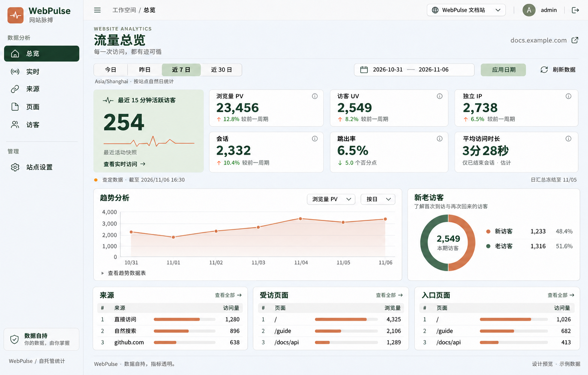

# WebPulse UI 布局设计

日期：2026-11-06。

状态：已按 v3 完成本地实现与验证，未部署。下图为设计参考，实际页面截图见后文。



当前版本：v3，主内容区与侧边栏背景统一为 `#f5f7fa`，保留深绿色导航选中状态；[初版](ui-redesign-concept.png) 与 [v2](ui-redesign-concept-v2.png) 保留。

## 布局与风格

- 按用户草图采用左侧固定导航、右侧独立顶栏和主内容区。
- 顶栏集中站点切换、面包屑和账号操作，日期筛选位于页面标题下方。
- 活跃访客大卡跨两行，其余六项指标按三列两行排列；下方为趋势与新老访客，再接三列排行。
- 主内容区与侧边栏背景统一为 `#f5f7fa`，保留森林绿导航与文字、陶土橙图表，细边框与适度圆角。
- 图中数字、日期、排行和图表为设计示例，不代表实际站点数据；实施时继续使用现有接口与统计口径。

## v3 实现与验收（2026-11-06）

已按当前设计实现左侧固定导航、独立顶栏、面包屑、站点切换、账号入口和统一页脚。侧边栏与主内容区背景为 `#f5f7fa`，白色卡片、森林绿选中状态和陶土橙图表保持一致。桌面侧栏支持键盘收起与展开；768–1099px 使用图标侧栏；手机使用底部六项导航。

总览保留七项核心指标，活跃访客卡跨两行，右侧按 PV、UV、IP、会话、跳出率、平均访问时长排列。新老访客环图使用 API 的范围占比，零访客和不可用分类均显示中性空环，数值仍分别显示 `0` 与 `—`。趋势保留缺失断点及可展开数据表，来源、受访页面与入口页面继续显示现有 Top 8。设计中的脉搏线仅作装饰，不表示活动历史。

日期预设、自定义范围、站点时区、URL 分享与后退、刷新、登录失效恢复、站点配置、暂停/恢复、保留预览、名称确认删除和同幂等键重试继续使用原有 API。实时、来源、页面、访客、站点设置与登录页同步使用新主题。切页回到顶部并将焦点置于主内容区；长路径在总览紧凑排行省略显示，可通过悬停标题或完整排行查看。

本次仅调整前端及浏览器验收，未变更服务端、数据库迁移、SDK、依赖或统计口径，也未执行提交、推送或部署。

### 页面截图

下列总览与设置截图使用模拟 API 数据；实时截图来自本机真实 HTTP/SSE 与独立临时 PostgreSQL schema，均不是生产站点数据。既有 M3/M4 截图保留。

| 宽度   | 总览                                      | 设置                                      | 实时                                      |
| ------ | ----------------------------------------- | ----------------------------------------- | ----------------------------------------- |
| 1440px | [总览](verification/ui-overview-1440.png) | [设置](verification/ui-settings-1440.png) | [实时](verification/ui-realtime-1440.png) |
| 1024px | [总览](verification/ui-overview-1024.png) | [设置](verification/ui-settings-1024.png) | [实时](verification/ui-realtime-1024.png) |
| 768px  | [总览](verification/ui-overview-768.png)  | [设置](verification/ui-settings-768.png)  | [实时](verification/ui-realtime-768.png)  |
| 390px  | [总览](verification/ui-overview-390.png)  | [设置](verification/ui-settings-390.png)  | [实时](verification/ui-realtime-390.png)  |
| 320px  | [总览](verification/ui-overview-320.png)  | [设置](verification/ui-settings-320.png)  | 本次未截取                                |

### 检查结果

| 检查                                                 | 结果                                             |
| ---------------------------------------------------- | ------------------------------------------------ |
| `pnpm typecheck`                                     | 通过，含所有工作区与测试类型                     |
| `pnpm lint`、`pnpm format:check`、`git diff --check` | 通过                                             |
| Ant Design CLI                                       | 已查询 Button、Select、Tooltip；前端 lint 0 问题 |
| `pnpm build`                                         | 通过；Vite 仍提示既有入口与图表 chunk 超过 500kB |
| `pnpm test`                                          | 64 项单元测试通过                                |
| `pnpm exec playwright test --workers=2`              | 21 项通过，1 项重复手机截图按原策略跳过          |

浏览器检查包括五宽无横向溢出、背景色精确匹配、六项导航和当前页语义、键盘收起/展开侧栏、日期与站点切换、空值/畸形响应、环图不可用与真实零值、长时长完整展示、图表数据表、配置保存、删除取消/确认/重试、弹窗焦点、Escape、登录失效及真实 SSE 多标签、隐藏暂停和重连。

真实联调在桌面与手机均使用构建后的前端、本机 HTTP 和随机独立 PostgreSQL schema；夹具自行清理测试资源，未修改既有站点、管理员或用户数据。首次沙箱内 Vite 监听被 `EPERM` 阻止，在允许本机监听的执行环境重跑后通过。此次未重跑独立 SDK 浏览器、PGlite、完整 PostgreSQL 专项或容器测试；它们的实现不在本次修改范围。未宣称真实读屏器、其他浏览器或线上部署验收。

机器可读结果见 [ui-redesign.json](verification/ui-redesign.json)。

## 初版生成方式与提示词

使用内置 image_gen 工具，通过 imagegen 技能生成。用户草图作为布局参考，生成全新的桌面总览设计图。以下为初版提示词，背景色以当前 v3 修订为准。

```text
Use case: ui-mockup.
Asset type: high-fidelity desktop web application UI design proposal, a single complete WebPulse analytics dashboard screenshot.
Primary request: Redesign the existing Chinese WebPulse self-hosted website analytics application, closely following the user's hand-drawn composition: a fixed narrow LEFT SIDEBAR, a horizontal TOP HEADER to its right, and a generous MAIN CONTENT workspace below the header. This is a precise, implementable product interface design, not a marketing page or a presentation slide.

Composition/framing: Straight-on, flat, crisp digital UI screenshot, landscape approximately 1600 x 1120, all interface content comfortably inside the frame. No laptop, device mockup, browser chrome, physical desk, perspective, extraneous labels outside the UI, or watermark. The sidebar occupies about 210 px of the total width. The right header is about 76 px tall, with a fine bottom divider. Main workspace has 28 px gutters, clear alignment and a restrained 16/24 px spacing system.

Visual direction: Quiet, refined, highly usable Chinese analytics SaaS. Warm ivory main canvas (#F6F5F0), slightly darker oatmeal sidebar (#EDEBE3), soft off-white cards (#FFFEFA), thin warm gray borders (#DFE1D8), dark forest green text (#263D32), muted sage secondary text (#778075). Active navigation is a solid deep forest-green rounded rectangle with white icon and text. Small terracotta-orange accents (#C77D58) for the chart and the brand pulse. Rounded cards about 12px, restrained control radius 7px, almost no shadows, no decorative gradients. Clear modern sans-serif Chinese typography, excellent numeric hierarchy, generous breathing room, fine line icons. The UI must look finished, legible and practical.

Sidebar: Top brand with a compact terracotta square containing a white pulse line, wordmark exactly "WebPulse", small subtitle "网站脉搏". Below, small section label "数据分析". Six vertically spaced navigation links with coherent thin outline icons, Chinese text exactly: "总览" (active), "实时", "来源", "页面", "访客". A divider and section label "管理", then "站点设置". Bottom of sidebar a subtle privacy card with shield icon and text "数据自持" and smaller "你的数据，由你掌握"; below a small "WebPulse / 自托管统计". Keep sidebar full height.

Top header: Left small sidebar-toggle icon, breadcrumb "工作空间 / 总览". Right a site dropdown with a globe icon and text "WebPulse 文档站", followed by a small divider and a circular avatar with "A", username "admin", and a compact logout icon. No fake connection or system health badges.

Main workspace:
1. A heading row with small eyebrow "WEBSITE ANALYTICS", large title exactly "流量总览", smaller subtitle "每一次访问，都有迹可循"; on the right a quiet site domain "docs.example.com" with a small external-link icon.
2. A clean compact filter toolbar: left a segmented date choice "今日", "昨日", "近 7 日", "近 30 日" with "近 7 日" selected using a light sage fill. Right calendar outlined custom date range "2026-10-31 — 2026-11-06", small "应用日期" button and icon+label "刷新数据". Beneath it small understated "Asia/Shanghai · 按站点自然日统计".
3. Seven metric cards arranged as an intentional balanced grid: a tall activity highlight card at the left spanning BOTH rows, and SIX individual cards to its right in THREE columns and TWO rows. The activity card has soft sage background, tiny outlined pulse icon, label "最近 15 分钟活跃访客", very large value "254", a subtle thin decorative pulse line (not a data chart), note "最近活动快照" and bottom text link "查看实时访问 →". The six ordinary cards show exactly: "浏览量 PV" value "23,456" comparison "↑ 12.8% 较前一周期"; "访客 UV" value "2,549" comparison "↑ 8.2% 较前一周期"; "独立 IP" value "2,738" comparison "↑ 6.5% 较前一周期"; "会话" value "2,332" comparison "↑ 10.4% 较前一周期"; "跳出率" value "6.5%" comparison "↓ 5.0 个百分点"; "平均访问时长" value "3分28秒" note "仅已结束会话 · 估计". Values dark forest green and prominent, comparison text small and readable, small quiet information icons in card corners. No sparklines or fabricated history inside metric cards.
4. A fine muted metadata line below metrics: small amber dot, "暂定数据 · 截至 2026/11/06 16:30" on left and "日汇总冻结至 11/05" on right.
5. Analysis row with two cards: wide left "趋势分析" (about 67% width), narrower right "新老访客". Trend card has small right selectors "浏览量 PV" and "按日", a clean terracotta-orange line chart with subtle pale fill, thin horizontal grid lines, readable x-axis dates 10/31 through 11/06, y-axis 0/1000/2000/3000/4000. Realistic uneven daily trend, no smooth extravagant curves. At bottom a small accessible disclosure "查看趋势数据表". Right card has subtitle "了解首次到访与再次回来的访客", a well-proportioned donut chart in terracotta and forest green, center value "2,549" and small "本期访客". Below two compact real-data legend rows: orange dot "新访客" "1,233" "48.4%"; green dot "老访客" "1,316" "51.6%". Keep balanced whitespace and legible typography.
6. Bottom row of THREE equally sized ranking panels with titles "来源", "受访页面", "入口页面", each with a small right "查看全部 →". Each panel is a compact 3-row table with rank numbers, names, subtle proportional bars and right-aligned counts. Sources: "直接访问" 1,280; "自然搜索" 896; "github.com" 638. Visited pages: "/" 4,325; "/guide" 2,106; "/docs/api" 1,289. Entry pages: "/" 1,026; "/guide" 682; "/docs/api" 413.
7. A very discreet footer with "WebPulse · 数据自持，指标透明。" and small right note "设计预览 · 示例数据".

Constraints: Produce ONE coherent polished desktop UI screenshot. Follow the sidebar/header/content structure. All primary text is simplified Chinese except the existing product wordmark, domain, date and numeric notation. Render Chinese text carefully, no gibberish, no lorem ipsum, no duplicated nav items or repeated headings. Preserve analytical clarity, use the exact seven metrics specified, no invented AI assistant, billing, sales, map, or unrelated functions. This is an illustrative design proposal with example data.
```

## v2 背景修订与最终编辑提示词

按用户指定将主背景改为 `#f5f7fa`。使用内置 image_gen 编辑初版设计图，仅调整主内容区背景，保留布局和其他配色；应用代码未修改。

```text
Use case: precise-object-edit.
Asset type: existing WebPulse desktop dashboard UI design mockup.
Edit target: the supplied image is the existing UI design. Change ONLY the main page/workspace background color to the exact solid sRGB hex color #f5f7fa (RGB 245, 247, 250).

Replace the warm ivory/beige main canvas behind the content to the RIGHT of the sidebar with a uniform flat #f5f7fa. This includes the main heading background, all whitespace around and between the metric cards and charts, the filter toolbar backdrop, metadata line backdrop, and the footer backdrop. The broad main background should visibly be a clean very light cool blue-gray, without texture, vignette, lighting effects, shadows, or gradient on the canvas. Retain original card interiors, sidebar, and top header surfaces.

Invariants: preserve the exact image size and composition, sidebar position and width, header, all text and Chinese typography, icons, existing card dimensions, borders, padding, chart shapes and all data, numbers, active navigation, forest-green text and terracotta accents. Do not rearrange, redesign, crop, add or remove any UI elements. Do not recolor the sidebar, card surfaces, selected light sage activity card, charts or buttons. This is a narrowly scoped background color revision of the same image.
```

## v3 侧边栏修订与最终编辑提示词

按用户要求将侧边栏背景同步改为 `#f5f7fa`，与主内容区一致。使用内置 image_gen 编辑 v2 设计图，保留导航选中状态及其余布局；应用代码未修改。

```text
Use case: precise-object-edit.
Asset type: existing Chinese WebPulse analytics dashboard design image.
Edit target: supplied v2 dashboard mockup.
Primary request: Recolor ONLY the LEFT SIDEBAR BACKGROUND to solid sRGB #f5f7fa (RGB 245, 247, 250), matching the main workspace background, as explicitly requested by the user.

The sidebar is the entire narrow vertical column from x=0 to about x=222, full image height. Replace its oatmeal/beige background behind the WebPulse logo, navigation links, section labels, and bottom privacy panel with the exact uniform very light cool gray-blue #f5f7fa. It should read as the same neutral background family as the main content canvas. Remove the sidebar's warm beige tint. Preserve a subtle right-hand divider so sidebar and content remain distinct.

Keep ALL OTHER image content intact: same dimensions, framing, layout, main workspace background #f5f7fa, header, cards, data, Chinese text, text placement, icons, logo, charts, borders and spacing. Keep the selected "总览" navigation item deep forest green with white text and icon. Preserve other forest-green text, terracotta accents, the pale green activity card, and the white privacy card. No redesign, no added features, no extra captions, no movement, no crop. Make only this sidebar background color correction.
```
